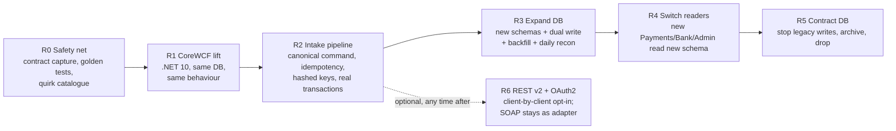
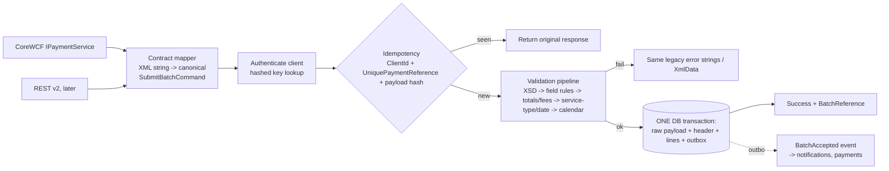

# BulkPayments Upgrade Playbook: Database First, Client Intake via CoreWCF (zero client impact)

*The approach I would take as the architect / senior developer on a bank-grade payments platform. It follows on from the Modernization Plan and the Target Service Design.*

---

## 0. Ground rules for changing a live payments system

1. **Never change the client contract and the data model in the same release.** Change the technology first with identical behaviour, then the data, then (optionally) the contract.
2. **Expand → migrate → contract.** New structures are *added* next to the old ones and both are kept in sync. Readers switch over one at a time. Old structures are removed last. Every step can be rolled back.
3. **Money must always reconcile.** Each step has an automated check: record counts and control totals per client, per batch and per day must match between old and new.
4. **Idempotent everywhere.** A client retrying an upload, or a message delivered twice, must never create a second payment.
5. **Immutable history.** Status changes are appended, never overwritten. Nothing that has touched money is hard-deleted.
6. **Behaviour parity is proven, not assumed.** Recorded production traffic is replayed and contracts are diffed (WSDL/XSD).



---

## R0. Safety net (before touching anything)

### R0.1 Freeze the client contract
The test project already has a generated proxy and XSDs, so the contract is known:

| Item | Value today | Must stay identical |
|---|---|---|
| Service namespace | `http://tempuri.org/` (no `Namespace` on `[ServiceContract]`) | yes |
| Contract name | `IPaymentService` | yes |
| SOAP actions | `http://tempuri.org/IPaymentService/{UploadBatch, PaymentBatch, CreateBankFile, Register, Submit, ResetAccessKey, Update, Rejections}` (+ `…Response`) | yes |
| Data contract namespace | `http://schemas.datacontract.org/2004/07/BulkPaymentLib`, which WCF derives from the **CLR namespace `BulkPaymentLib`** | yes. If you rename or move the classes, add `[DataContract(Namespace = "http://schemas.datacontract.org/2004/07/BulkPaymentLib")]` explicitly |
| `BatchUploadResponse`, `PaymentBatchRequest`, `PaymentBatchResponse`, `Employee`, `BankRunResponse` | `[DataContract]` with default (alphabetical) member order | yes. Don't add `Order=` or `IsRequired=` |
| **`BulkPaymentResponse`** | **No `[DataContract]` attribute.** It is serialized as a POCO with all public properties in alphabetical order: `AccessKey, Message, Status, XmlData`. | yes. **Do not "tidy it up" by adding `[DataContract]` without marking every member.** |
| Endpoint path | `/PaymentService.svc` | yes, the same URL, including `?wsdl` |
| Binding | not visible in the files I read (I didn't open `.config` files). With no explicit endpoint, WCF 4 uses **`basicHttpBinding`** (SOAP 1.1). | **Confirm from `Web.config` `<system.serviceModel>`** |

Actions:
- Save the **production WSDL and XSDs** (`?wsdl`, `?xsd=xsd0..n`) into the repo as the contract baseline.
- **Record real traffic** for 2–4 weeks with WCF message logging or a logging reverse proxy in front of IIS. Store it encrypted, because it contains PII.
- Build a **replay harness**: send each recorded request to a test stack, compare the response XML after normalising dynamic values (GUID `BatchReference`, timestamps), and compare the resulting DB rows.

### R0.2 Catalogue the behaviour quirks clients may rely on
These come from `BulkPaymentModule.UploadBatch` and `MidTier.Helpers.Extensions`. Each one gets a golden test and a decision: keep it as-is, or change it with client communication.

| # | Current behaviour | Risk on .NET 10 / Linux | Decision |
|---|---|---|---|
| 1 | `ToDecimal()` swaps `.` for the **server's current-culture** decimal separator, then calls `decimal.Parse`. | Containers often run with **invariant globalization**, or a different culture than the Windows server. Amounts could parse differently or fail. | **Pin the culture** to whatever production uses (likely `en-ZA`) inside intake, and test with real amounts: `1234.56`, `1 234,56`, `1,234.56`. |
| 2 | `ToDateTime()` uses culture-dependent `DateTime.Parse`, and an **empty PaymentDate becomes `DateTime.Now`**. | Same culture risk; the empty-date fallback silently accepts bad input. | Keep it in R1. In R2, decide whether to reject (needs client comms) or keep. |
| 3 | The footer total may equal *sum of amounts* **or** *sum + billing rate × count*. | none | Keep, and document it. |
| 4 | Service-type aliases: `SDV`/`SAMEDAY`, `1 DAY`/`1DAY`/`ONEDAY`/`ONE DAY`, `2 DAY`..., `RTL`; **anything else is treated as DW**. | none | Keep. Log unknown values to find out which clients send them. |
| 5 | Sundays and public holidays are rejected at upload; **Saturdays are accepted**. | none | Keep. |
| 6 | Response `Message` texts come from `BulkPaymentResource` (`Msg_InvalidAccessKey`, `Msg_ValueMismatch`, …). Clients may match on these strings. | Changing text breaks clients that parse it. | **Freeze the exact strings** as constants. |
| 7 | When an exception occurs, the client receives `ex.Message` (internal detail leaks). | Security finding. | Return a generic message plus a correlation id. Same field, safer content. |
| 8 | Duplicate `UniquePaymentReference` is **not** detected, so a retry creates a second batch. | Risk of paying twice. | In R2, return the **original successful response, with the same BatchReference**, for an identical resubmission. Clients see success either way; nothing breaks. |
| 9 | `Rejections` validates against the *payment* XSD, runs a proc with empty parameters and **always returns Failure**. | It is effectively dead. | Check the traffic logs for callers. Keep the operation in the WSDL and return the same response. |
| 10 | `CreateBankFile` always returns "not available". | none | Keep the stub so existing proxies don't break. |
| 11 | Header insert and bulk insert are **not in one transaction**; the "rollback" is a manual delete. | Partial batches. | Fix in R2. Clients see no difference. |

### R0.3 Other safety nets
- Golden files for the Nedbank outgoing file and the ACK/NACK/Unpaid parsers (needed later).
- Put the DB schema into source control (SSDT or DbUp baseline from `bulkpayments_script.sql`).
- Daily **control-total report** per client per payment date, used as the reconciliation check in every later phase.

---

## R1. CoreWCF lift: same contract, same database, same behaviour

**Goal:** clients keep the same URL, WSDL, SOAP actions and responses. Only the hosting technology changes: .NET Framework/IIS WCF becomes .NET 10 + ASP.NET Core + CoreWCF.

### R1.1 Project layout
```
src/Intake/
  BulkPayments.Intake.Contracts     // IPaymentService + data contracts, CLR namespace BulkPaymentLib kept (or explicit Namespace attrs)
  BulkPayments.Intake.Application   // UploadBatch/Register/... handlers (ported BulkPaymentModule logic, no statics)
  BulkPayments.Intake.Legacy        // Dapper repositories calling the EXISTING sp_* procs + SqlBulkCopy into dbo.Transactions
  BulkPayments.Intake.Host          // ASP.NET Core + CoreWCF (+ later REST v2)
tests/Intake/
  Contract.Tests (WSDL/XSD diff), Replay.Tests, Rules.GoldenTests
```

### R1.2 Host (sketch)
```csharp
var builder = WebApplication.CreateBuilder(args);
builder.Services.AddServiceModelServices().AddServiceModelMetadata();
builder.Services.AddSingleton<IServiceBehavior, UseRequestHeadersForMetadataAddressBehavior>();
builder.Services.AddScoped<PaymentService>();                 // DI-friendly service class
builder.Services.AddIntakeApplication(builder.Configuration); // handlers, repositories, options

var app = builder.Build();
app.UseServiceModel(sm =>
{
    sm.AddService<PaymentService>(o => o.DebugBehavior.IncludeExceptionDetailInFaults = false);
    // Mirror the legacy binding exactly (confirm from Web.config): basicHttpBinding, SOAP 1.1, text encoding
    var binding = new BasicHttpBinding(BasicHttpSecurityMode.Transport)
    {
        MaxReceivedMessageSize = /* same as legacy readerQuotas/maxReceivedMessageSize */ 50 * 1024 * 1024,
        ReaderQuotas = { MaxStringContentLength = int.MaxValue }
    };
    sm.AddServiceEndpoint<PaymentService, IPaymentService>(binding, "/PaymentService.svc");
    var smb = app.Services.GetRequiredService<ServiceMetadataBehavior>();
    smb.HttpGetEnabled = smb.HttpsGetEnabled = true;          // keeps ?wsdl working
});
app.Run();
```
Notes:
- **Message size limits.** Batches arrive as one XML string, so copy `maxReceivedMessageSize` and `readerQuotas` from `Web.config` exactly. Otherwise large payrolls will fail.
- **HTTP vs HTTPS.** If some clients call plain HTTP today, expose both endpoints in R1, then plan an HTTPS-only date with those clients.
- **WSDL shape.** CoreWCF may lay out the WSDL differently from .NET Framework WCF (for example, how it imports the XSDs). The messages on the wire are what matter, but **diff the generated schema types** and test regenerating a proxy with `svcutil` and `dotnet-svcutil`.
- **Hosting.** Linux container behind a reverse proxy, or Windows/IIS via the ASP.NET Core Module if you want to keep the same servers in R1.
- **Culture.** Set `CultureInfo.DefaultThreadCurrentCulture` to the production culture, or better, pass an explicit `IFormatProvider` in the ported `ToDecimal`/`ToDateTime`, and turn off invariant globalization mode.

### R1.3 Cut-over with no client impact
Because R1 writes to **the same database through the same stored procedures**, the old and new stacks can run side by side safely:
1. Deploy the new host on a new internal address.
2. Run the replay harness against it until 100% of responses match.
3. In the reverse proxy (IIS ARR, YARP, F5 or Azure Front Door) keep the public URL and send **5% → 25% → 100%** of `/PaymentService.svc` traffic to the new host. Watch error rates and the daily control-total report.
4. Rollback is a routing change. Retire the old IIS site after 2 full month-end cycles.

---

## R2. Intake pipeline hardening (still the legacy tables, still the same contract)

Rebuild the internals behind the unchanged SOAP operations:



- **One canonical command.** Both SOAP and the future REST API map into `SubmitBatchCommand`, so business rules exist once.
- **Hashed access keys without client impact.** Add `client.ClientCredential(KeyPrefix, KeyHash)`. A migration script computes `HMAC-SHA256(pepper, existingKey)` for every current key. Lookup is by hash, so **clients keep using exactly the same key**. Drop the plaintext column in R5.
- **Raw payload retention.** Store every received XML (compressed, encrypted at rest) with its SHA-256 hash. It is the evidence in a dispute ("what exactly did the client send?").
- **Transactions.** Header, lines (`SqlBulkCopy` inside the same `SqlTransaction`), the idempotency record and the outbox row are committed together.
- **Throughput.** Validation streams the payload (`XmlReader`) instead of deserialising the whole thing several times. Set a configurable maximum batch size, with the same limit the legacy service effectively had.
- **Observability.** Correlation id per submission, metrics per client (count, value, rejections, latency), alerts on unusual value spikes (a fraud signal).

---

## R3. Database redesign: expand next to the legacy schema

### R3.1 Why expand-in-place (same SQL Server, new schemas)
- The legacy Admin, Windows Service and Statements API keep working on `dbo.*` untouched.
- Intake can **dual-write in one local transaction** (no distributed transactions), because the old and new tables are in the same database.
- Moving the new schemas to their own databases later is a hosting change, not a redesign.

### R3.2 Core DDL (intake + client + payments; bank and notify schemas follow the same patterns)

```sql
CREATE SCHEMA client;   CREATE SCHEMA intake;   CREATE SCHEMA payments;   CREATE SCHEMA ref;
GO
-- Reference data
CREATE TABLE ref.ServiceType (
  ServiceTypeId tinyint      NOT NULL CONSTRAINT PK_ServiceType PRIMARY KEY,
  Code          varchar(10)  NOT NULL CONSTRAINT UQ_ServiceType_Code UNIQUE,   -- SDV, RTL, 1DAY, 2DAY, DW
  Description   varchar(50)  NOT NULL,
  MinLeadDays   tinyint      NOT NULL,                                       -- business rule as data
  CutOffTime    time(0)      NULL
);
CREATE TABLE ref.PublicHoliday (HolidayDate date NOT NULL CONSTRAINT PK_PublicHoliday PRIMARY KEY, Name varchar(100) NULL);

-- Clients (primary/secondary collapsed into one self-referencing table)
CREATE TABLE client.Client (
  ClientId          int IDENTITY      NOT NULL CONSTRAINT PK_Client PRIMARY KEY,
  ParentClientId    int               NULL CONSTRAINT FK_Client_Parent REFERENCES client.Client(ClientId),
  ExternalClientId  varchar(50)       NOT NULL,                 -- today's UniqueClientId
  Name              nvarchar(100)     NOT NULL,
  StatusId          tinyint           NOT NULL CONSTRAINT DF_Client_Status DEFAULT 1,
  AutoProcess       bit               NOT NULL CONSTRAINT DF_Client_Auto DEFAULT 0,
  LegacyPrimaryClientId   int NULL,  LegacySecondaryClientId int NULL,   -- traceability during migration
  CreatedAtUtc      datetime2(3)      NOT NULL CONSTRAINT DF_Client_Created DEFAULT sysutcdatetime(),
  RowVer            rowversion,
  CONSTRAINT UQ_Client_External UNIQUE (ParentClientId, ExternalClientId)
);
CREATE TABLE client.ClientCredential (
  CredentialId  int IDENTITY NOT NULL CONSTRAINT PK_ClientCredential PRIMARY KEY,
  ClientId      int          NOT NULL CONSTRAINT FK_Cred_Client REFERENCES client.Client(ClientId),
  KeyHash       binary(32)   NOT NULL CONSTRAINT UQ_Cred_Hash UNIQUE,   -- HMAC-SHA256(pepper, key)
  KeyPrefix     char(6)      NOT NULL,                                -- for support/display only
  CreatedAtUtc  datetime2(3) NOT NULL DEFAULT sysutcdatetime(),
  RevokedAtUtc  datetime2(3) NULL
);
CREATE TABLE client.ClientContact (
  ContactId    int IDENTITY NOT NULL PRIMARY KEY,
  ClientId     int          NOT NULL REFERENCES client.Client(ClientId),
  ContactType  tinyint      NOT NULL,   -- 1 Upload, 2 Rejection, 3 Funding, 4 PaymentConfirmation
  Name nvarchar(100) NULL, Email varchar(254) NULL, Cell varchar(20) NULL
);   -- replaces NotificationXml blobs on SecondaryClient/Header

-- Intake: what the client sent, exactly
CREATE TABLE intake.Submission (
  SubmissionId           bigint IDENTITY  NOT NULL CONSTRAINT PK_Submission PRIMARY KEY,
  BatchReference         uniqueidentifier NOT NULL CONSTRAINT UQ_Submission_BatchRef UNIQUE,
  ClientId               int              NOT NULL REFERENCES client.Client(ClientId),
  UniquePaymentReference varchar(50)      NOT NULL,
  Channel                tinyint          NOT NULL,         -- 1 SOAP v1, 2 REST v2
  PayloadSha256          binary(32)       NOT NULL,
  PayloadBlobRef         varchar(400)     NOT NULL,         -- or varbinary(max) compressed+encrypted
  StatusId               tinyint          NOT NULL,         -- 1 Accepted, 2 Rejected
  ResponseJson           nvarchar(max)    NULL,             -- exact response returned (for idempotent replay)
  ReceivedAtUtc          datetime2(3)     NOT NULL DEFAULT sysutcdatetime(),
  CONSTRAINT UQ_Submission_Idem UNIQUE (ClientId, UniquePaymentReference)   -- idempotency
);

-- Payments: the canonical batch (system-versioned = automatic history, replaces Header_Audit)
CREATE TABLE payments.PaymentBatch (
  BatchId                bigint IDENTITY  NOT NULL CONSTRAINT PK_PaymentBatch PRIMARY KEY,
  BatchReference         uniqueidentifier NOT NULL CONSTRAINT UQ_PaymentBatch_Ref UNIQUE,
  ClientId               int              NOT NULL,          -- no cross-schema FK once services split
  ClientName             nvarchar(100)    NOT NULL,          -- local copy
  UniquePaymentReference varchar(50)      NOT NULL,
  ServiceTypeId          tinyint          NOT NULL,
  PaymentDate            date             NOT NULL,
  ControlRecordCount     int              NOT NULL,
  ControlTotal           decimal(18,2)    NOT NULL,
  ReconStatusId          tinyint          NOT NULL CONSTRAINT DF_PB_Recon DEFAULT 2,  -- 1 Reconciled 2 Unreconciled 3 Discrepancy
  ReconSourceId          tinyint          NULL,                                     -- 1 Manual 2 Statement
  PaymentStatusId        tinyint          NOT NULL CONSTRAINT DF_PB_Pay DEFAULT 1,    -- Pending/Released/Submitted/Ack/Paid/PartRejected/Cancelled
  RejectionAccountName   nvarchar(100)    NULL,
  RejectionBranchCode    char(6)          NULL,
  RejectionAccountNo     varchar(16)      NULL,
  LegacyHeaderId         int              NULL CONSTRAINT UQ_PB_Legacy UNIQUE,
  CreatedAtUtc           datetime2(3)     NOT NULL DEFAULT sysutcdatetime(),
  UpdatedBy              nvarchar(100)    NULL,
  RowVer                 rowversion,
  ValidFrom datetime2(3) GENERATED ALWAYS AS ROW START HIDDEN NOT NULL,
  ValidTo   datetime2(3) GENERATED ALWAYS AS ROW END   HIDDEN NOT NULL,
  PERIOD FOR SYSTEM_TIME (ValidFrom, ValidTo),
  CONSTRAINT CK_PB_Total CHECK (ControlTotal >= 0 AND ControlRecordCount > 0)
) WITH (SYSTEM_VERSIONING = ON (HISTORY_TABLE = payments.PaymentBatchHistory));

CREATE TABLE payments.PaymentLine (
  LineId          bigint IDENTITY NOT NULL CONSTRAINT PK_PaymentLine PRIMARY KEY,
  BatchId         bigint          NOT NULL CONSTRAINT FK_Line_Batch REFERENCES payments.PaymentBatch(BatchId),
  LineNo          int             NOT NULL,
  EmployeeCode    varchar(50)     NOT NULL,
  Surname         nvarchar(100)   NOT NULL,
  FirstName       nvarchar(100)   NULL,
  Initials        varchar(5)      NULL,
  IdOrPassport    varbinary(256)  NULL,          -- encrypted (Always Encrypted / app-level), POPIA
  Cell            varchar(20)     NULL,
  Email           varchar(254)    NULL,
  BranchCode      char(6)         NOT NULL,
  AccountNo       varchar(16)     NOT NULL,
  AccountTypeId   tinyint         NOT NULL,
  Amount          decimal(18,2)   NOT NULL CONSTRAINT CK_Line_Amount CHECK (Amount > 0),
  BeneficiaryRef  varchar(50)     NULL,          -- today's BankReference (statement narrative)
  LineStatusId    tinyint         NOT NULL DEFAULT 1,
  RejectionReason nvarchar(500)   NULL,
  LegacyTransactionId int         NULL,
  CONSTRAINT UQ_Line_No UNIQUE (BatchId, LineNo)
);

-- Append-only status history (consider SQL Server 2022 append-only LEDGER table for tamper evidence)
CREATE TABLE payments.BatchStatusEvent (
  EventId bigint IDENTITY PRIMARY KEY, BatchId bigint NOT NULL REFERENCES payments.PaymentBatch(BatchId),
  FromStatus tinyint NULL, ToStatus tinyint NOT NULL, StatusKind char(1) NOT NULL, -- R=recon, P=payment
  Actor nvarchar(100) NOT NULL, Reason nvarchar(500) NULL, OccurredAtUtc datetime2(3) NOT NULL DEFAULT sysutcdatetime()
);
CREATE TABLE payments.BatchComment (CommentId bigint IDENTITY PRIMARY KEY, BatchId bigint NOT NULL REFERENCES payments.PaymentBatch(BatchId),
  Actor nvarchar(100) NOT NULL, Body nvarchar(2000) NOT NULL, CreatedAtUtc datetime2(3) NOT NULL DEFAULT sysutcdatetime());

-- Reliable messaging
CREATE TABLE intake.Outbox (MessageId uniqueidentifier PRIMARY KEY, Type varchar(200) NOT NULL, Body nvarchar(max) NOT NULL,
  OccurredAtUtc datetime2(3) NOT NULL, DispatchedAtUtc datetime2(3) NULL);
CREATE INDEX IX_PB_Recon ON payments.PaymentBatch (ReconStatusId, PaymentStatusId, PaymentDate) INCLUDE (ClientName, ControlTotal, ControlRecordCount);
```
(`bank.*`: `BankProfile`, `PaymentInstruction`, `BankRun`, `BankFileLine`, `BankResponse`. `notify.*`: `Template`, `Dispatch`, `DispatchAttempt`. Both are as in the Target Service Design §7.2.)

Design choices worth calling out:
- **`decimal(18,2)`, not `money`.** It avoids rounding surprises in division and aggregation. Totals are checked with `CHECK` constraints.
- **Control totals stored separately from line sums.** The batch keeps what the client *declared*; a view or check compares that with what was *received*.
- **Temporal tables** give a full point-in-time history automatically (SQL Server 2016+), replacing `Header_Audit` and `_Rej` copies. **Ledger tables** (SQL Server 2022+) make the status history tamper-evident, which auditors like.
- **`Legacy*Id` columns** make migration traceable and reversible. Drop them in R5.
- **`rowversion`** gives optimistic concurrency for multiple Ops users working the same grid.
- **PII.** ID/passport numbers are encrypted; account numbers are masked in the UI and logs; retention and purge jobs cover POPIA.

### R3.3 Getting data into the new schema
1. **Dual write (new data).** In R2/R3, intake writes legacy `dbo.Header`/`dbo.Transactions` **and** `intake.Submission` + `payments.PaymentBatch`/`PaymentLine` in **the same transaction**. Legacy readers notice nothing.
2. **Keep in sync (changes made by legacy apps).** The WinForms Admin and Windows Service still update `dbo.Header`/`Transactions`/`Rejections`/`BankRun`. Copy those changes into the new schema with **Change Tracking/CDC plus a sync worker** (or triggers that write to a sync queue table) until those apps are retired in R4.
3. **Backfill (history).** A rerunnable ETL moves legacy rows into the new tables, keyed by `Legacy*Id`. It is idempotent (upsert), runs in chunks, and moves clients (`PrimaryClient`/`SecondaryClient` + parsed `NotificationXml` → `ClientContact`) first.
4. **Verify every day.** An automated job compares counts and `SUM(Amount)` per client per payment date per status between `dbo` and the new schemas. Any difference blocks the next phase and alerts the team.

---

## R4. Switch readers, then R5 contract the legacy schema
- The new **Payments API / Admin UI** and **Bank File worker** read and write the **new** schemas.
- From this point the direction of the sync worker **flips**: new → legacy, only for whatever legacy component remains (e.g. the Statements API still reading `dbo.Header`) until it is updated.
- **R5:** stop legacy writes; set `dbo.*` read-only; archive it (keep for regulatory retention, typically 5+ years for financial records; confirm your obligation); drop the plaintext `AccessKey` columns; remove the `Legacy*Id` columns.

---

## R6. Client channel strategy: keep SOAP, add REST, migrate by choice

| Option | Client impact | When |
|---|---|---|
| **Keep SOAP on CoreWCF permanently**, as a thin adapter onto `SubmitBatchCommand` | none | Default for clients who won't change |
| **REST v2** (`POST /v2/batches`, JSON or XML body, `Idempotency-Key` header, OAuth2 client credentials or mTLS, OpenAPI spec, async status endpoint and optional webhook) | opt-in | New clients, and existing ones at their next integration upgrade |
| **SFTP drop** (same XML schema) | opt-in | Bureaus that prefer file transfer |

All channels feed the same handler, so rules, idempotency and audit are identical everywhere. Track **usage per client per channel**; only announce a SOAP sunset when usage is low, with 6–12 months' notice.

---

## Delivery sequence and gates

| Release | Exit gate (all automated where possible) |
|---|---|
| R0 | WSDL/XSD baseline saved; ≥2 weeks of recorded traffic; golden tests green; control-total report live |
| R1 | 100% replay parity; WSDL/XSD diff shows only accepted cosmetic differences; canary at 100% for 2 month-ends; zero client tickets |
| R2 | Replay parity, except deliberate fixes #7 and #8 (communicated); duplicate-submission test proves idempotency; load test at 3× peak month-end volume |
| R3 | Backfill complete; daily reconciliation shows zero differences for 10 business days |
| R4 | New Payments/Bank paths in production; bank-file golden comparison passed in shadow mode |
| R5 | Legacy writes off; archive verified; credentials hashed only |

---

## What I need from you
1. **The `<system.serviceModel>` section of `src/BulkPaymentService/Web.config`** (mask the addresses): binding type, security mode, `maxReceivedMessageSize`, `readerQuotas`. CoreWCF has to match it exactly.
2. **Server culture** of the production IIS box (`en-ZA`, `en-US`, …), plus a couple of anonymised sample XMLs from different clients. This is for the amount/date parsing parity in quirks #1 and #2.
3. **SQL Server version and edition.** Temporal tables need 2016+, ledger tables 2022+, Always Encrypted with secure enclaves needs Enterprise.
4. **Can you capture production SOAP traffic** (message logging or a proxy) for the replay harness?
5. **How many integrated clients are there, and on what stacks** (.NET proxies, Java, PHP, …)? Non-.NET SOAP clients are stricter about WSDL details.
