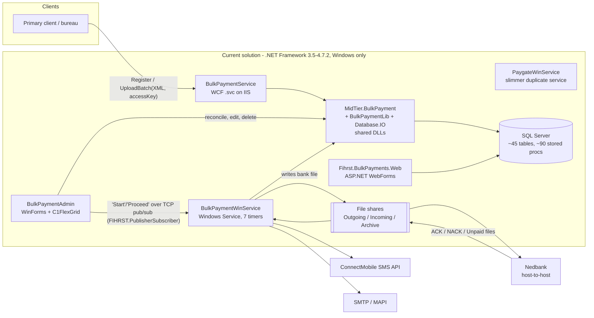
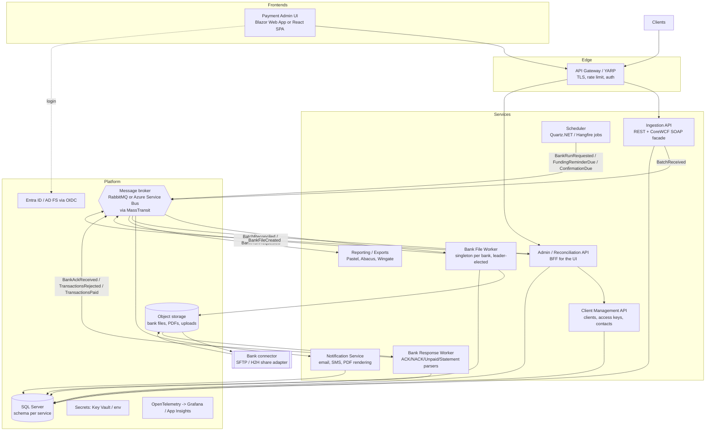
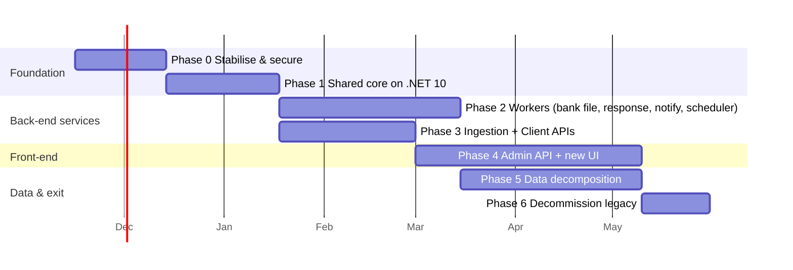

# BulkPayments: Current-State Analysis and .NET Modernization Plan

Scope: `c:\repos\BulkPayments\src` (17 projects, ~31k lines of C#, 2 SQL scripts). I read the code in full but not the `.config` files, so bindings, endpoints and connection details are inferred from the code.

---

## 1. What the system does

This is FIHRST's bulk salary/creditor payment gateway. In the code it goes by "BulkPayments" or "Paygate". **Clients** (payroll bureaus, financial institutions) send payment batches. **Operations staff** reconcile those batches against client funding. The system then builds **Nedbank** bank files and processes the bank's replies.



### 1.1 End-to-end business flow (as implemented)

| # | Step | Where in code |
|---|------|---------------|
| 1 | **Client onboarding.** A primary client (holding a primary access key) calls `Register`, which creates a *secondary* client with its own access key and notification contacts (`NotificationInfo` XML). | `BulkPaymentModule.Register`, `sp_SecondaryClient_Insert` |
| 2 | **Batch upload.** `UploadBatch` / `Submit(accessKey, xml)` checks the XML against `BulkPaymentXml.xsd`, then validates field rules, footer totals vs line totals (billing fees per service type allowed), record count, service type vs payment date (SDV, 1-Day, 2-Day, RTL, DW), Sundays and public holidays. It then inserts a `Header` and bulk-inserts `Transactions`, and queues an upload-confirmation email/SMS with a PDF. | `BulkPaymentModule.UploadBatch` |
| 3 | **Funding chase.** Scheduled jobs send *unreconciled / funding request* notices to client contacts and an hourly "Live Unfunded Data" PDF to managers. | `OutgoingFileModule.UnReconciledNotification`, `SendFundingRequestToManagers` |
| 4 | **Reconciliation (Payment Admin).** Ops log in with a domain account and work the tabs **Unreconciled → Reconciled / Discrepancies**, plus PaidAway, History, Bank Runs and Auto-Reconciled. They can change payment date or service type, add comments, delete batches and handle bank rejections. Every action is written to `ActivityLog`. | `frmBulkPaymentAdmin`, `PaymentAdmin`, `HeaderMgr`, `sp_Header_*` |
| 5 | **Bank file creation.** Runs hourly inside a configured window, or on demand when Ops press **Process Payments**, which sends `Start` over TCP to the Windows service. It picks *reconciled* headers plus pending re-submittable rejections, increments the running and daily sequence (`BankClientProfile`), and writes a Nedbank fixed-width file (`{env}{clientId}I{seq}.D0.SQ320`) to the outgoing share. It also archives the file, creates a `BankRun`, sets transactions to *Transmitted*, and emails Ops a batch-detail PDF. FNB, Standard Bank and Absa are stubs. | `OutgoingFileModule.CreateBankFileRun`, `NedbankFile` |
| 6 | **Bank pick-up watchdog.** Alerts if a file sits in the outgoing folder longer than `MinutesForBankToClearOutgoingFile`. | `OutgoingFileQueueWatcher` |
| 7 | **Bank responses.** Polls the incoming share for `…A` (**ACK**), `…N` (**NACK**) and `…O` (**Unpaid/returns**) files (258-char records). It updates `BankRun` and `Transactions` status, creates `Rejections`, sends rejection-confirmation PDFs to clients, archives the file and notifies Ops. | `IncomingFileModule`, `IncomingAck/Nack/UnpaidFile` |
| 8 | **Payment confirmation.** At a configured hour, clients get a PDF confirming what was paid. | `PaymentConfirmationModule` |
| 9 | **Notification dispatch.** Every N seconds, sends queued emails (`Dispatch` table, template placeholders) and SMS via the ConnectMobile HTTP API. | `NotifyModule.SendQueuedNotifiactions`, `SendSms` |
| 10 | **Extracts.** `sp_BankRuns_PastelFile_Create`, `sp_AbacusPayments` and the `Wingate*` tables point to accounting/ERP exports that are done in SQL. | SQL script |

> **Statement files:** you mentioned bank statement files. I found **no statement-file parser** in this repo; only ACK, NACK and Unpaid are handled. Either it lives in another system or it is still to be built. The plan below treats it as a new parser in the Bank Response service.

### 1.2 Project inventory

| Project | Type / framework | Role | Target in new design |
|---|---|---|---|
| `BulkPaymentService` | WCF `.svc` web app, 4.7.2 | Client-facing SOAP API (8 operations; `CreateBankFile` is a stub) | **Ingestion API** |
| `PaymentService` | WCF service library, 4.0 | Essentially empty | Delete |
| `MidTier.BulkPayment` | Library, 4.7.2 | All business logic: upload, recon, bank files, incoming files, notifications, PDFs | Split across domain libraries and services |
| `BulkPaymentLib` | Library, 4.7.2 | DTOs / entities, incoming record layouts, permission model | `Payments.Contracts` + `Payments.Domain` |
| `Database.IO` | Library, 4.7.2 | `*Mgr` stored-proc wrappers returning `DataTable`/`DataSet` (via closed-source `FIHRST.Database`) | Repositories (Dapper) per service |
| `DatabaseHandler` | Library, 4.0 | A second, home-grown `DbContext` (ADO.NET + TVPs) | Merge into the repositories above, then delete |
| `NotificationHandler` | Library, 4.0 | SMTP / MAPI / dispatch queue (overlaps closed-source `FIHRST.Notifications`) | **Notification service** |
| `MidTier.Helpers` | Library, 4.0 | DataTable/XML/PDF extension methods (iTextSharp 5) | Shared kernel (trimmed) |
| `BulkPaymentWinService` | Windows Service, 4.7.2 | 7 timers: notifications, SMS, incoming, outgoing, watchdog, funding, unreconciled, confirmations; TCP pub/sub listener | **Bank File worker**, **Bank Response worker**, **Scheduler**, **Notification worker** |
| `PaygateWinService` | Windows Service, 4.0 | Partial duplicate of the above (on-demand bank file only) | Delete |
| `BulkPaymentAdmin` | WinForms, 4.7.2 | The Payment Admin (recon UI) | **Admin UI + Admin API** |
| `BulkPaymentSendNotification` | WinForms, 4.7.2 | Manual notification sender | Feature in Admin UI |
| `Fihrst.BulkPayments.Web` | WebForms, 4.7.2 | Web portal: login, clients, security/permission config, auditing, transactions, PDF export | **Admin UI** (settings/security/audit areas) |
| `Fihrst.MiddleTier.Web` | Library, 4.5 | Duplicate of web permission classes | Delete |
| `FlexigridASPNET.Control` | Library, **3.5** | jQuery Flexigrid WebForms control | Delete (replaced by modern data grid) |
| `BulkPayment.UnitTest` | MSTest + **Coded UI** | DB-bound integration tests | xUnit/NUnit + Testcontainers |
| `BulkConsoleTest` | Console | WCF client harness | Becomes API contract tests |

### 1.3 Risks in the current code that shape the plan

**Security (fix now, independent of the migration)**
- **Hard-coded SMTP username/password** in `PaygateWinService/PaygateService.cs` (`OnStart`), committed to git. Rotate that mailbox password and remove the code.
- Hard-coded debug auto-login credentials in `Fihrst.BulkPayments.Web/Account/Login.aspx.cs` (`LogMeIn`, `[Conditional("DEBUG")]`).
- SMS provider credentials are sent in the **query string** (`BulkPaymentWinService.SendSms`), so they land in proxy and server logs.
- Client authentication is a plain access key passed as a SOAP parameter. I could not confirm whether keys are stored hashed.

**Correctness / reliability**
- `BusySubmittingFile` has an empty setter (`set {; }`) in both Windows services, so it is **always false**. The guard against two bank runs happening at once does nothing. Only `PendingResponse` (wait for the previous ACK) protects the bank sequence numbers.
- `ProcessOutgoingFile` calls itself recursively with `Thread.Sleep(30s)`.
- Static mutable state (`MidTierBase.AppSettings`, `BaseIO.databaseObjForWin`, `LastRun`) makes it unsafe to run more than one instance of anything.
- Errors are often swallowed (`catch (Exception) {}`) or rethrown after unreachable code.
- `UploadBatch` "rolls back" by deleting the header by hand, with no DB transaction.
- Log paths are hard-coded (`C:\Documentation\...`, `D:\Data\TimerLog.txt`), and processing is coupled to the file system through UNC/local folders.

**Platform blockers for .NET (Core)**
- WCF server (`System.ServiceModel` hosting): not available. Options are CoreWCF or REST.
- WinForms + ComponentOne `C1FlexGrid` 2016: WinForms runs on .NET but Windows-only, and the C1 version needs a license upgrade.
- WebForms: not supported at all, so a rewrite is required.
- MAPI email (`MapiEmail`, P/Invoke to `MAPI32.dll`): Windows-only; replace.
- **iTextSharp 5** (AGPL/commercial): replace with QuestPDF or PdfSharp/MigraDoc, or buy an iText 8 license.
- **Closed-source binaries with no source in the repo:** `FIHRST.Helpers`, `FIHRST.Notifications`, `FIHRST.PublisherSubscriber`, `FIHRST.Database`, `FIHRST.Flexgrid`, `WBaseClassLibrary`, `WebCore`, `DataCore`, `WebConnectDataCommon`, `WSys.Web.TreeListView`. **This is the biggest unknown.** For each one you need either the source or a replacement. The code uses `IsDomainUser`, `NotifyModule`, `LogActivityModule`, `LogExceptionModule`, `ToPdf`, `Deserialize<T>`, `PublisherSubscriberClient` and DataTable mapping from these.

**Data**
- About 90 stored procedures and 5 table-valued parameter (TVP) types hold real business logic (`fn_GetNextworkingday`, auto-recon, Pastel/Abacus exports). There are `_Rej` and `_Audit` shadow tables.
- `PaymentGateway Scripts.sql` is a newer, cleaner target schema (`PaymentBatches`, `PaymentSummaries`, `PaymentRecords`, `Users`, `UserRoles`). It is **not yet runnable**: its foreign keys point at non-existent columns/tables (`PaymentBatches(Id)`, `ServiceTypes`, `PaymentStatuses`, `AccountTypes`, `TransactionStatusId`). The plan treats it as the starting point for the new data model.

---

## 2. Target architecture

### 2.1 Principles
- **Target .NET 10 (LTS, supported to Nov 2028).** .NET 8 LTS support ends Nov 2026, so don't start a migration on it now.
- **Strangler-fig migration.** Each component is replaced in production one at a time, behind the same contracts. No big-bang cut-over.
- **Bounded contexts communicate by events, not shared DLLs or a shared static state.**
- **Keep the database at first.** Wrap the existing stored procedures, then move tables out per service as each one stabilises.
- **Cloud-agnostic by default** (containers, a message broker, object storage). Works on Azure (AKS/Container Apps), on-prem Kubernetes, or Windows Server hosts.

### 2.2 Components



| Component | Replaces | Responsibility | How it scales |
|---|---|---|---|
| **Ingestion API** (ASP.NET Core Web API) | `BulkPaymentService` WCF | Authenticate client, validate batch (XSD + rules + totals + calendar), persist, publish `BatchReceived`. Offers both a **CoreWCF SOAP endpoint with the identical contract** for existing integrators and a new **REST/JSON + file upload** endpoint. Idempotency on `UniquePaymentReference`. | Stateless; scale out horizontally. Large batches go to blob storage and are validated asynchronously. |
| **Client Management API** | `Register`, `Update`, `ResetAccessKey`, Clients page | Primary/secondary clients, hashed API keys (OAuth2 client-credentials later), notification contacts, bank accounts, billing rates. | Low traffic, small. |
| **Admin / Reconciliation API** | `PaymentAdmin`, `HeaderMgr`, recon logic in WinForms | Queries for each tab, recon status changes, payment-date/service-type edits with `ValidatePaymentChanges`, comments, deletes, rejection handling, auto-reconciliation, audit log. Publishes `BatchReconciled` and `BankRunRequested`. | Stateless; scale out. Read models / paged queries replace full-table DataTables. |
| **Payment Admin UI** | `BulkPaymentAdmin` (WinForms), `Fihrst.BulkPayments.Web` (WebForms), `BulkPaymentSendNotification` | Browser app: recon grids with grouping, subtotals, inline edit, export (Excel/PDF), the "Process Payments" button, bank-run history, security/role config, audit viewer. Uses Entra ID / AD sign-in, replacing `IsDomainUser`. | Static or SSR hosting, CDN. |
| **Bank File Worker** | `OutgoingFileModule`, `NedbankFile`, outgoing timers, TCP pub/sub | Consumes `BankRunRequested` from either the scheduler window or a manual request. Takes a **distributed lock per bank profile**. Checks no ACK is pending (or that Ops overrode it), allocates sequence numbers in one DB transaction, builds the file through `IBankFileFormat` (Nedbank now; FNB, Standard Bank, Absa as plug-ins), uploads it and publishes `BankFileCreated`. Includes the pick-up watchdog. | **Single active instance per bank** (leader election / lock), because sequence numbers must be strictly ordered. Scale by bank, not by replica. |
| **Bank Response Worker** | `IncomingFileModule`, Ack/Nack/Unpaid parsers | Triggered by new files (blob event, SFTP poll or folder watcher). Parses ACK, NACK, Unpaid and **Statement** files with `IBankResponseParser`. Updates transaction and bank-run state, publishes `BankAckReceived`, `TransactionsRejected` and `TransactionsPaid`. Archives the raw file. | Competing consumers, one message per file. Idempotent on file name + hash. |
| **Notification Service** | `NotifyModule`, `Dispatch` table, `SendSms`, MAPI, iTextSharp PDFs, `EmailContent` templates | Subscribes to domain events and renders templates and PDFs (QuestPDF). Sends email (SMTP/SendGrid/Graph) and SMS with retry, backoff and a dead-letter queue. Keeps a delivery log. | Scale out freely. Provider throttling handled with rate limits. |
| **Scheduler** | `System.Timers` in Windows services | Cron-style jobs: bank-run windows, funding reminders, unreconciled notices, payment confirmations, manager reports. **Business-day calendar** (`PublicHoliday`, `fn_GetNextworkingday`) is a shared service. Jobs only *publish commands*; they don't do the work. | One active node (Quartz clustered / Hangfire). |
| **Reporting / Exports** | `sp_BankRuns_PastelFile_Create`, `sp_AbacusPayments`, Wingate tables | Accounting/ERP exports driven by `BankFileCreated` / `TransactionsPaid`. | Batch. |

### 2.3 Key domain events (contracts project)
`ClientRegistered`, `BatchReceived`, `BatchValidated`/`BatchRejected`, `BatchReconciled`, `BatchUnreconciled`, `BatchUpdated`, `BankRunRequested{bank, manual, overridePendingAck, requestedBy}`, `BankFileCreated{bankRunId, fileName, sequence, totals}`, `BankAckReceived`, `BankNackReceived`, `TransactionsRejected`, `TransactionsPaid`, `StatementReceived`, `NotificationRequested`.

Use the **transactional outbox** (MassTransit EF/SQL outbox) so a DB write and its event are never out of sync. This is critical for payments.

### 2.4 Cross-cutting choices

| Concern | Today | Proposed |
|---|---|---|
| Runtime | .NET Framework 3.5–4.7.2 | **.NET 10**, SDK-style projects, nullable on, `Directory.Packages.props` (central package management) |
| Hosting | IIS + Windows Services | Linux containers (Docker) on AKS / Container Apps / on-prem k8s. Windows Service hosting via `UseWindowsService()` is an interim option. |
| Data access | DataTable + closed-source `FIHRST.Database` + home-grown DbContext | **Dapper** over existing procs at first, then **EF Core** for new schemas. **DbUp** or EF migrations in CI. |
| Messaging | TCP pub/sub DLL + DB polling | **MassTransit** on RabbitMQ (on-prem) or Azure Service Bus |
| Files | Local/UNC folders | Object storage (Blob/S3/MinIO) plus a **bank connector** adapter for the bank's transport (SFTP or H2H share) |
| Scheduling | `System.Timers` + `Thread.Sleep` | Quartz.NET (clustered) or Hangfire |
| Config / secrets | `web.config` / `app.config`, settings table, hard-coded passwords | `IOptions<T>` + environment + **Key Vault**. Feature flags for cut-over. |
| AuthN/Z | AD bind (`IsDomainUser`), forms auth, custom permission tables | **Entra ID / AD FS (OIDC)** for staff; policy-based authorization that ports the `Area/Permission/Policy` model. Clients: hashed API keys, then OAuth2 client credentials. |
| PDF | iTextSharp 5 | QuestPDF (community licence is free under a revenue threshold) or PdfSharp/MigraDoc |
| Observability | Text files, email-on-error | Serilog + **OpenTelemetry** (traces across API → broker → worker), health checks, alerts instead of error emails |
| Tests | DB-bound MSTest, Coded UI | xUnit, **golden-file tests for bank formats**, Testcontainers (SQL Server, RabbitMQ), Playwright for UI, API contract tests |
| CI/CD | none in repo | GitHub Actions / Azure DevOps: build, test, scan (SAST, dependency check), container image, deploy per service |

---

## 3. Migration roadmap

Durations assume a team of 3–4 developers plus QA and are rough. The order is chosen so the riskiest, money-moving pieces get the most parallel-run time.



### Phase 0: Stabilise and secure (≈3–4 weeks)
1. **Rotate** the SMTP password exposed in `PaygateService.cs` and the SMS credentials. Remove secrets from code and git history, and turn on secret scanning.
2. Clean the repo: `.gitignore` for `bin/obj/.vs/_ReSharper*/TestResults`; move third-party DLLs into a private NuGet feed or a documented `lib/` folder.
3. **Inventory the closed-source FIHRST/WBase/WebCore DLLs.** Get the source or decompile to list the members actually used, and decide *port vs. replace* for each.
4. Put the database under source control (an SSDT project or DbUp scripts generated from `bulkpayments_script.sql`). Fix `PaymentGateway Scripts.sql`.
5. **Characterisation tests** (the safety net for everything after):
   - Golden files: given fixed `Header`/`Transactions` input, the Nedbank outgoing file must be byte-identical.
   - Parser tests for real (anonymised) ACK, NACK and Unpaid files.
   - Upload validation rules: totals, billing fees, service-type/date rules, holidays.
   - WCF contract snapshot (WSDL) so the SOAP facade can be checked against it later.
6. Fix the `BusySubmittingFile` no-op setter and remove the recursive sleep. This is a small, high-value production fix.
7. Set up a CI pipeline that builds the legacy solution and runs these tests.

### Phase 1: Shared core on .NET 10 (≈4–5 weeks)
1. Convert all projects to SDK-style. Retarget pure libraries to `netstandard2.0` (or multi-target `net472;net10.0`) so **legacy apps and new services share one codebase during the transition**.
2. Extract new libraries:
   - `Payments.Contracts`: DTOs, events, the SOAP data contracts.
   - `Payments.Domain`: batch validation rules, service-type/calendar logic, recon state machine, billing.
   - `Payments.BankFormats.Abstractions` + `Payments.BankFormats.Nedbank`: `IBankFileFormat` and `IBankResponseParser`, taken from `NedbankFile` and `Incoming*` with **no I/O and no static state**.
   - `Payments.Infrastructure.Sql`: Dapper repositories wrapping the existing `sp_*` procedures, returning POCOs instead of DataTables.
3. Replace static `AppSettings`/`ConnectionName` with dependency injection and `IOptions`. Replace `FIHRST.*` usages with your own interfaces (`INotificationQueue`, `IActivityLog`, `IPdfRenderer`, `IClock`, `IBusinessCalendar`).
4. Point the legacy WinForms, WCF and Windows Service apps at these libraries so they keep working while you migrate.

### Phase 2: Back-end workers (≈6–8 weeks)
Run them **in parallel with** the legacy Windows Service first, in shadow mode: the new code writes to a shadow folder and table, and the output is diffed against legacy. Then switch over one job at a time with feature flags.
1. **Notification Service:** consume `NotificationRequested`; port templates and PDF generation to QuestPDF; SMTP and SMS providers with retry and DLQ; credentials in headers or body, not the URL.
2. **Bank Response Worker:** ACK/NACK/Unpaid parsers from Phase 1, plus a new **Statement parser** (ask Nedbank for the spec, e.g. MT940/CAMT.053 or their proprietary layout). Idempotent processing, raw files archived to blob storage.
3. **Bank File Worker:** leader-elected, with sequence allocation in a serializable transaction (or `sp_getapplock`). Includes the pick-up watchdog. Manual runs arrive as a `BankRunRequested` message from the Admin API, which replaces the TCP pub/sub. **Cut over only after N business days of byte-identical shadow output.**
4. **Scheduler:** port all timer schedules to cron jobs that publish commands.
5. Retire `BulkPaymentWinService` and `PaygateWinService`.

### Phase 3: Ingestion and Client Management APIs (≈5–6 weeks; can overlap Phase 2)
1. ASP.NET Core host with **CoreWCF**, exposing the *same* `IPaymentService` contract, namespace and binding so existing clients need no changes. Check against the WSDL snapshot.
2. New versioned REST endpoints: `POST /v1/batches` (JSON or XML; large files via pre-signed upload), `GET /v1/batches/{ref}` (replaces `PaymentBatch`), `POST /v1/clients`, `POST /v1/clients/{id}/keys:rotate`.
3. Hash access keys, add rate limiting, put the APIs behind the gateway, and give each client an OpenAPI spec.
4. Wrap each upload in a single DB transaction with an outbox, replacing the delete-the-header "rollback".
5. Switch DNS / the IIS reverse proxy from the old `.svc` to the new host, with a rollback switch.

### Phase 4: Admin API and new Payment Admin UI (≈8–10 weeks)
1. **Admin API (BFF):** endpoints for each tab (Unreconciled, Reconciled, Discrepancies, PaidAway, History, BankRuns, AutoReconciled, Rejections), with server-side paging, grouping and subtotals. Bulk actions mirror `ChangeReconStatus`, `ChangePaymentDate`, `ChangeServiceType`, `AddComment`, `Delete`, `UpdateBankRejections`, plus `POST /bank-runs` for "Process Payments", which shows the pending-ACK warning and accepts an override. Full audit trail.
2. **UI technology:**
   - **Blazor Web App** with a commercial grid (Telerik, Syncfusion, DevExpress or MudBlazor DataGrid) lets the team stay all-C# and is the closest to C1FlexGrid behaviour: grouping, subtotals, inline edit, Excel export.
   - **React or Angular** with AG Grid fits better if you have, or want, front-end specialists.
   - I recommend **Blazor** for a C#-centric team.
3. Merge in the WebForms pages (security/permission config, clients, auditing, transactions) and the manual "send notification" tool.
4. Sign-in through Entra ID / AD FS; map AD groups to the ported `Area/Permission/Policy` model.
5. Pilot with a few Ops users while the WinForms app is still available read-only. Then retire WinForms and WebForms.

### Phase 5: Data decomposition (≈6–8 weeks, ongoing)
1. Give each service its own **schema** (`ingest.*`, `recon.*`, `bank.*`, `notify.*`, `client.*`) in the same SQL Server, with each service owning its tables. Other services read through APIs or events, not cross-schema joins.
2. Move logic out of stored procedures into the domain layer step by step, starting with the procs behind recon and bank-run selection. Keep reporting procs as read models.
3. Adopt the cleaned-up `PaymentGateway` model (PaymentBatch → PaymentSummary → PaymentRecord) as the target schema. Migrate data with backfill scripts and dual-write during transition.
4. Separate physical databases only where scale or isolation needs it; Ingestion and Notification are the likely first candidates.

### Phase 6: Decommission (≈2–3 weeks)
Remove the WCF host, Windows Services, WinForms, WebForms, the Flexigrid control, the duplicate libraries (`PaymentService`, `Fihrst.MiddleTier.Web`, `DatabaseHandler`, `PaygateWinService`) and the closed-source DLLs. Archive the legacy branch.

---

## 4. Proposed solution layout

```
/src
  /BuildingBlocks
    Payments.Contracts            (events, DTOs, SOAP data contracts)
    Payments.Domain               (rules, calendar, recon state machine)
    Payments.BankFormats.Abstractions
    Payments.BankFormats.Nedbank
    Payments.Infrastructure       (Sql, Messaging, Storage, Pdf, Observability)
  /Services
    Ingestion.Api                 (ASP.NET Core + CoreWCF)
    ClientManagement.Api
    Reconciliation.Api            (Admin BFF)
    BankFile.Worker
    BankResponse.Worker
    Notification.Worker
    Scheduler.Worker
    Reporting.Worker
  /Web
    PaymentAdmin.Web              (Blazor Web App)
  /Gateway
    Gateway.Yarp
/db                               (DbUp / SSDT, one folder per schema)
/tests
  *.UnitTests, *.IntegrationTests (Testcontainers), BankFormats.GoldenFiles, PaymentAdmin.E2E (Playwright)
/deploy
  docker-compose.yml (local: SQL Server, RabbitMQ, Azurite/MinIO, MailHog)
  helm/ or bicep/ or terraform/
.NET Aspire AppHost (optional): local orchestration and dashboards
```

---

## 5. Risks and mitigations

| Risk | Impact | Mitigation |
|---|---|---|
| Closed-source FIHRST/WBase DLLs hide behaviour | Wrong ports, blocked migration | Phase 0 inventory; interface wrappers; characterisation tests around each usage |
| Bank file format drift (sequence numbers, padding, totals) | Rejected or duplicated payments | Golden-file tests, shadow runs, single-writer lock, bank UAT sign-off before cut-over |
| Duplicate bank runs or double payment | Financial loss | Distributed lock, idempotency keys, outbox, keep the pending-ACK check, a reconciliation report for every run |
| Existing clients integrated with WCF/SOAP | Client outages | CoreWCF facade with the identical contract; WSDL diff in CI; long deprecation window for SOAP |
| Business logic buried in ~90 stored procedures | Hidden behaviour changes | Wrap first, move later; SQL unit tests (tSQLt) on critical procs |
| Ops adoption of the new UI | Productivity drop | Feature parity checklist per tab, pilot users, keep keyboard/grid ergonomics |
| Licensing (C1FlexGrid, iTextSharp AGPL) | Legal/compliance | Replace with QuestPDF and a licensed modern grid |

---

## 6. Decisions needed from you
1. **Hosting target:** Azure (Container Apps/AKS + Service Bus + Blob), on-prem Kubernetes (RabbitMQ + MinIO), or Windows Server VMs as a first step?
2. **External SOAP clients:** are third parties calling the WCF service today? That decides whether the CoreWCF facade is mandatory.
3. **UI stack:** Blazor (recommended for a C# team) or React/Angular?
4. **Statement files:** where are they processed today, and what format does Nedbank send (MT940, CAMT.053, proprietary)?
5. **Source for the `FIHRST.*` / `WBaseClassLibrary` / `WebCore` DLLs:** is it available?
6. **Bank transport:** how do files reach Nedbank today (a share synced by Connect:Direct/SFTP, or something else)? The bank connector design depends on it.
