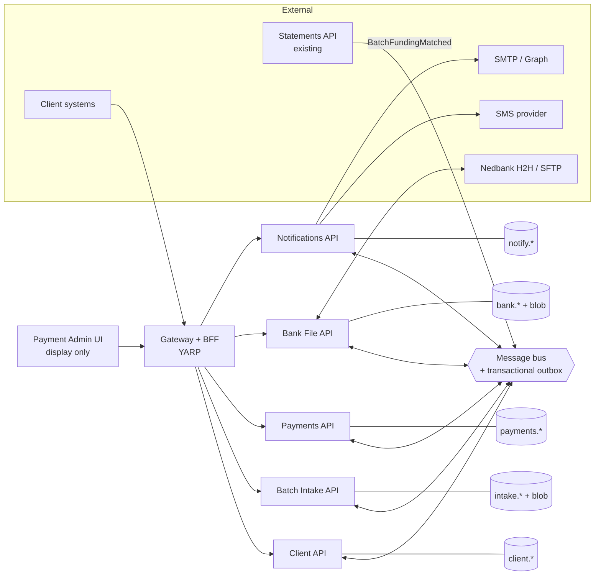
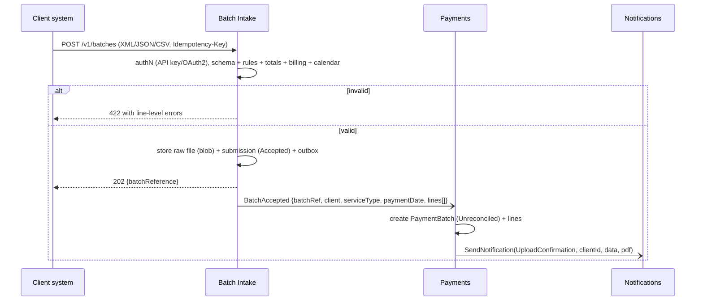
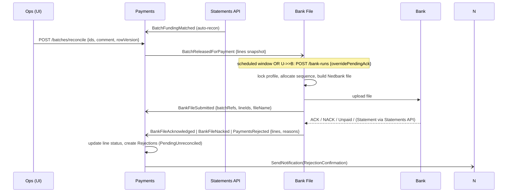
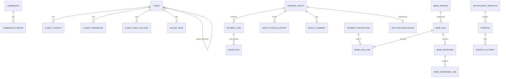

# BulkPayments Rewrite: Service Boundaries, Data Model and API Design

A review of the proposed five-API split, plus a recommended target design. It is based on `bulkpayments_script.sql`, `PaymentGateway Scripts.sql`, the current code and the Payment Admin screenshot.

---

## 1. Verdict on your proposal

Your five areas (Client, Batch File, Payments, Notifications, Bank File) are the right **bounded contexts**. I'd keep all five. My changes are about **who owns which data and how the services talk to each other**:

| # | Your proposal | Concern | Recommendation |
|---|---|---|---|
| 1 | **Bank File API** creates files, reads responses **and updates the batches in the DB** | If two services write the same tables, they are not really decoupled. Every schema change in Payments would break Bank File, and there is no single owner of batch status. | Bank File owns **only** bank runs, bank files, file lines, sequences and raw response files. It **publishes events** (`BankFileSubmitted`, `BankFileAcknowledged`, `PaymentsRejected`, `PaymentsConfirmed`). **Payments consumes those events** and updates its own batches and rejections. |
| 2 | **Bank File** pulls batches from the DB at file-creation time | It would need read access to Payments tables, and the file contents can drift from what was approved (someone edits or unreconciles mid-run). | When a batch is reconciled, Payments **releases** it with `BatchReleasedForPayment`, carrying the payment lines. Bank File keeps an **immutable snapshot** (`bank.PaymentInstruction`) and builds files only from that. Unreconciling after release becomes `BatchReleaseRevoked`, which Bank File honours only if the lines are not already in a file. |
| 3 | **Batch File API** and **Payments API** both "own" batches | They would share the same aggregate and tables. | **Batch Intake** owns the *raw submission*: file/XML, validation result, idempotency, staging. Once valid, it publishes `BatchAccepted` and **Payments creates the canonical batch**. Intake never touches payments tables, and Payments never parses files. |
| 4 | **Notifications API** receives inserts from other services | Synchronous HTTP inserts couple every service to Notifications being up, and recipients/contacts would be duplicated in every caller. | Producers send a **`SendNotification` command on the bus** (template key, client id, data, attachment refs). Notifications owns templates and the dispatch queue and resolves recipients from its **local copy of client contacts** (fed by `ClientContactsChanged`). It also exposes a small REST API for the UI (templates, dispatch log, resend). |
| 5 | **UI** calls the APIs directly | One grid row (e.g. Unreconciled) needs data from Payments **and** Client, so the browser would make many calls (N+1) and need to know five base URLs and auth audiences. | Put an **API gateway (YARP) with a thin BFF** in front. Each service keeps **local read copies** of the few fields it needs from others, e.g. Payments stores `ClientName`, refreshed by `ClientUpdated`. Screens become single calls. |
| 6 | Missing contexts | Staff users and permissions, reference data (service types, public holidays, settings, halt switch), billing, audit, the existing **Statements API**, accounting exports (Pastel/Abacus/Wingate). | Staff identity goes to **Entra ID / OIDC**, with app roles in a small **Admin/Identity** module. **Reference data** (business calendar) becomes a shared module. **Billing** sits under Client for now. **Audit** uses an event-sourced log in each service plus a central query. The **Statements API publishes `BatchFundingMatched`**, and Payments applies auto-reconciliation. |
| 7 | Five separately deployed microservices on day one | Operating cost: five pipelines, five databases, distributed debugging. Usually too much for a small team. | Keep **five modules with hard boundaries** (own schema, own events, no cross-module table access). **Deploy them as 4 hosts, grouped by how they scale** (§3). Any module can be pulled out into its own deployable later without code changes. |

---

## 2. Bounded contexts and ownership

| Service | Owns (source of truth) | Keeps local copies of | Publishes | Consumes |
|---|---|---|---|---|
| **Client** | Primary/secondary clients, API credentials (hashed), contacts (upload, rejection, funding), client bank accounts (nominated, charges, rejection), billing rates, logos | none | `ClientRegistered`, `ClientUpdated`, `ClientContactsChanged`, `ClientCredentialRotated`, `ClientSuspended` | none |
| **Batch Intake** | Raw submissions (blob), validation results, idempotency keys, intake status | Client id/status, billing rates, business calendar | `BatchAccepted` (with lines), `BatchRejectedAtIntake` | `ClientUpdated`, `ClientSuspended` |
| **Payments** | Payment batches, payment lines, recon status and history, comments, rejections, auto-recon results | Client name and rejection account | `BatchReconciled`, `BatchUnreconciled`, `BatchMarkedDiscrepant`, `BatchReleasedForPayment`, `BatchReleaseRevoked`, `RejectionReleasedForResubmission`, `SendNotification` | `BatchAccepted`, `BankFileSubmitted`, `BankFileAcknowledged`, `BankFileNacked`, `PaymentsRejected`, `PaymentsConfirmed`, `BatchFundingMatched` (Statements), `ClientUpdated` |
| **Bank File** | Bank profiles and sequences, payment instructions (snapshot), bank runs/files, file lines, raw response files, parsed responses, halt switch | none (everything arrives on release) | `BankFileCreated`, `BankFileSubmitted`, `BankFileAcknowledged`, `BankFileNacked`, `PaymentsRejected`, `PaymentsConfirmed`, `BankNotCollectingFiles`, `SendNotification` (ops) | `BatchReleasedForPayment`, `BatchReleaseRevoked`, `RejectionReleasedForResubmission` |
| **Notifications** | Templates (per client + type), dispatch queue (today's `Dispatch` table), delivery attempts, rendered documents (PDFs) | Client contacts | `NotificationSent`, `NotificationFailed` | `SendNotification`, `ClientContactsChanged` |

**Rule:** no service reads another service's schema. Data crosses boundaries only through events, or through a synchronous API call where it has to be real-time (rare).

---

## 3. Deployment grouping (recommended start)

| Deployable | Contains | Why grouped / separate | Scaling |
|---|---|---|---|
| **Public Intake host** | Batch Intake API | Internet-facing with untrusted input and bursty traffic (month-end payroll). Isolate it for security and capacity. | Horizontal autoscale; big uploads go straight to blob storage via a pre-signed URL. |
| **Core API host** | Client API, Payments API, Notifications API (REST side), Bank File API (REST side), Admin/Reference modules, BFF | Internal, low-volume CRUD and queries, used by Ops. | 2+ replicas, horizontal. |
| **Bank File worker** | Bank file builder, response parsers, sequence allocator, watchdog | **Must be a single writer per bank profile**, because file sequence numbers must be strictly ordered. | One active instance (leader lock) plus a standby. |
| **Notification worker** | Email/SMS senders, PDF renderer | Queue-driven; provider rate limits. | Scale on queue depth. |
| **UI** | Payment Admin SPA | Static hosting. | CDN. |

When load justifies it, move Payments or Client out of the Core host into their own deployables. The module boundaries already allow that.

---

## 4. Key flows

### 4.1 Client batch upload → Unreconciled

### 4.2 Reconciliation → bank file → bank responses

**Rejection resubmission** (the bottom grid in your screenshot): Ops reconcile rejections in Payments, which publishes `RejectionReleasedForResubmission`. Bank File adds them as new instructions paid to the client's **rejection account**, which is today's `Rejections` → next bank file loop.

---

## 5. Payment Admin tabs → API calls

The UI does no business logic. Every grid is one `GET` and every action is one `POST`/`PATCH`; validation, permissions and audit run on the server.

| Tab (today) | Data source | Proposed endpoint | Actions (server-side) |
|---|---|---|---|
| **Un-reconciled** (top grid) | `Header` where ReconStatus=2 | `GET /payments/v1/batches?reconStatus=Unreconciled` | `POST /batches/reconcile`, `/mark-discrepancy`, `PATCH /batches/{id}` (payment date / service type, with `ValidatePaymentChanges` rules), `POST /batches/{id}/comments`, `POST /batches/{id}/cancel` (soft delete) |
| **Un-reconciled** (bottom grid: rejections) | `Rejections` status PendingUnreconciled | `GET /payments/v1/rejections?status=PendingUnreconciled` | `POST /rejections/reconcile` (→ resubmit), `/unreconcile` |
| **Reconciled** | ReconStatus=1, not yet in a bank file | `GET /payments/v1/batches?reconStatus=Reconciled&released=false` | `POST /batches/unreconcile` (blocked once in a file) |
| **Discrepancies** | ReconStatus=3 | `GET /payments/v1/batches?reconStatus=Discrepancy` | reconcile / unreconcile / comment |
| **Paid Away** | Lines with `TransactionStatus = Success`, paid today | `GET /payments/v1/paid?date=today` (rolled up per batch) | read-only, export |
| **History** | Lines with `TransactionStatus = Success`, date range | `GET /payments/v1/paid?from=&to=` (same endpoint as Paid Away) | read-only, export |
| **Batch Runs** | `sp_BankRunSummary` | `GET /bankfiles/v1/bank-runs?from=&to=` + `GET /bank-runs/{id}` (files, batches, totals, ACK/NACK) + `GET /bank-runs/{id}/file` (download) | `POST /bankfiles/v1/bank-runs` ("Process Payments", returns 409 + pending file name if an ACK is outstanding; `overridePendingAck=true` to force), halt/resume |
| **Auto Reconciled** | `ReconciledBatches` (written by Statements API) | `GET /payments/v1/batches?reconSource=Statement` or `GET /payments/v1/auto-reconciliations` (variance, available balance, statement file) | accept/override a variance |
| *(WebForms)* Clients, Security, Auditing | various | Client API, Admin module, `GET /audit/v1/events` | as today |
| *(WinForms)* Send Notification | `Dispatch` | Notifications API `GET /dispatches`, `POST /dispatches/{id}/resend` | |

Paid Away and History are the same view (successful payments), as you confirmed: today vs a chosen date range.

Grouping, subtotals and sorting: the API returns paged results with `groupBy=client` and totals, so the grid only renders them.

---

## 6. API surface (v1, REST/JSON, OpenAPI per service)

**Client API** (`/clients/v1`)
- `POST /clients` (register secondary under the caller's primary), `GET /clients`, `GET /clients/{id}`, `PATCH /clients/{id}`, `POST /clients/{id}/suspend|activate`
- `POST /clients/{id}/credentials` (rotate key; returns the secret once), `DELETE /credentials/{id}`
- `GET|PUT /clients/{id}/contacts` (typed: Upload, Rejection, Funding, PaymentConfirmation)
- `GET|PUT /clients/{id}/bank-accounts`, `GET|PUT /clients/{id}/billing-rates`

**Batch Intake API** (`/intake/v1`)
- `POST /batches` (XML today; JSON/CSV later; `Idempotency-Key` header) → 202 + `batchReference`
- `POST /batches/uploads` → pre-signed URL for large files; `GET /batches/{ref}/status` (validation errors)
- **SOAP facade (CoreWCF)** with the legacy `UploadBatch`/`Submit`/`Register`/`ResetAccessKey`/`Update`/`PaymentBatch` contract, so existing integrators keep working. It forwards to the same handlers.

**Payments API** (`/payments/v1`)
- `GET /batches` (filters above, paging, groupBy), `GET /batches/{id}` (lines, comments, recon history, bank status)
- `POST /batches/reconcile|unreconcile|mark-discrepancy` (bulk; body `{ids[], comment, rowVersions[]}`)
- `PATCH /batches/{id}` (paymentDate, serviceType), `POST /batches/{id}/comments`, `POST /batches/{id}/cancel`
- `GET /rejections`, `POST /rejections/reconcile|unreconcile`
- `GET /auto-reconciliations`
- `GET /clients/{clientId}/batches/{ref}`: client-facing batch status (replaces `PaymentBatch`)

**Bank File API** (`/bankfiles/v1`)
- `GET /bank-runs`, `GET /bank-runs/{id}`, `GET /bank-runs/{id}/file`, `POST /bank-runs`
- `GET /responses` (ACK/NACK/Unpaid received, parsed summary), `POST /responses/{id}/reprocess`
- `GET|PUT /profiles/{bank}` (window, cut-offs), `POST /halt`, `POST /resume`

**Notifications API** (`/notifications/v1`)
- `GET|POST|PUT|DELETE /templates` (per client + type, email/SMS, placeholders)
- `GET /dispatches?status=&clientId=`, `POST /dispatches/{id}/resend`, `POST /dispatches` (manual send from UI)

---

## 7. Database review

### 7.1 Problems in `PaymentGateway Scripts.sql`

**It won't run as written:**
- `go;` is not valid T-SQL (use `GO`), and there is no `USE PaymentGateway` after `CREATE DATABASE`.
- `PaymentSummaries` → `REFERENCES PaymentBatches(Id)`, but the PK column is `PaymentBatchId`.
- Foreign keys point at tables that don't exist: `ServiceTypes`, `PaymentStatuses`, `AccountTypes`, `TransactionStatuses`.
- `PaymentRecords` has an FK on `TransactionStatusId`, but the column is named `StatusId`.
- `Users(UserId)` and `CreatedByUserId → Users(UserId)` are referenced, but the column is `Id`. `Users` is also created *after* the tables that reference it.
- `sp_PaymentBatch_Get` still selects from the old `Header`/`Transactions` tables.

**Modelling issues (more important than the syntax):**
1. **`PaymentBatches` is really a bank run.** Its comments map it to `FileSequenceNumber`, `BankFileName`, `BankRunReason` and the Sent/ACK/NACK statuses. **`PaymentSummaries` is really the client's batch** (today's `Header`). The naming will confuse everyone, because clients call their upload a "batch".
2. **`PaymentSummaries.PaymentBatchId NOT NULL`** means a client upload must belong to a bank file the moment it is inserted. But at upload time no bank file exists; it is created hours later after reconciliation. **The schema can't represent an unreconciled batch.**
3. **One record → one bank file** is wrong. NACKed files are resent, and rejected lines are resubmitted in later files to the rejection account. The relationship between a payment line and a bank file is **one-to-many over time**, so it needs a link table (`BankFileLine`).
4. `UniqueReference UNIQUE` is global. Uniqueness should be **per client** (`ClientId + UniquePaymentReference`). That is also your idempotency key.
5. Clients, contacts, rejections, comments, recon history, sequences, notifications, holidays and billing are all **missing**. `NotificationXml` (a blob of contacts) should become a proper contacts table.
6. **`Users` with `PasswordHash`:** if staff sign in with Entra ID / AD (today's admin already uses domain login), don't store passwords. Store the IdP subject id and app roles only.
7. `NVARCHAR(MAX)` for branch codes and account names should have fixed lengths (branch `CHAR(6)`, account `VARCHAR(16)`).
8. **No concurrency control.** Several Ops users editing the same grid need a `rowversion`.
9. **Hard deletes** (`sp_Header_Delete`) lose the audit trail. Use soft cancel plus a status history table.
10. **PII** (ID/passport numbers, account numbers, cell numbers) needs protection under **POPIA**: Always Encrypted or column encryption for ID numbers, masking in the UI and logs, and a retention policy.

### 7.2 Recommended schema (one schema per service, same SQL Server to start)

| Schema | Tables (key columns) | Replaces |
|---|---|---|
| `client` | `Client(Id, ParentClientId NULL, ExternalClientId, Name, Status, LogoBlobRef, AutoProcess, RowVersion)` · `ClientCredential(Id, ClientId, KeyPrefix, KeyHash, CreatedAt, RevokedAt)` · `ClientContact(Id, ClientId, Type{Upload,Rejection,Funding,Confirmation}, Name, Email, Cell)` · `ClientBankAccount(Id, ClientId, Purpose{Nominated,Charges,Rejection}, AccountName, AccountNo, BranchCode, AccountType)` · `BillingRate(ClientId, ServiceType, Rate, EffectiveFrom)` | `PrimaryClient`, `SecondaryClient`, `NotificationXml`, `BankAccount*`, `BillingRates*` |
| `intake` | `Submission(Id, ClientId, UniquePaymentReference, IdempotencyKey, BlobRef, Format, Status{Received,Accepted,Rejected}, ReceivedAt, BatchReference)` UNIQUE(ClientId, UniquePaymentReference) · `SubmissionError(SubmissionId, Line, Field, Code, Message)` | validation code in `BulkPaymentModule` |
| `payments` | `PaymentBatch(Id, BatchReference GUID, ClientId, ClientName*, UniquePaymentReference, ServiceType, PaymentDate, TotalRecords, TotalValue, ReconStatus{Unreconciled,Reconciled,Discrepancy}, ReconSource{Manual,Statement}, PaymentStatus{Pending,Released,Submitted,Acknowledged,Paid,PartiallyRejected,Cancelled}, RejectionAccount*, RowVersion, CreatedAt, UpdatedAt)` · `PaymentLine(Id, BatchId, LineNo, EmployeeCode, Surname, FirstName, Initials, IdNumber (encrypted), Cell, Email, BranchCode, AccountNo, AccountType, Amount, BankReference, Status, RejectionReason)` · `BatchStatusHistory(BatchId, From, To, Actor, Reason, At)` · `BatchComment(Id, BatchId, Actor, Text, At)` · `Rejection(Id, PaymentLineId, BankRunRef, Reason, Status{PendingUnreconciled,Reconciled,Resubmitted,Paid}, Amount)` · `AutoReconciliation(BatchId, StatementRef, AvailableBalance, Variance, MatchedAt)` | `Header`, `Transactions`, `HeaderComment`, `Header_Audit`, `Rejections`, `ReconciledBatches` |
| `bank` | `BankProfile(Id, Bank, ClientIdentifier, RunningSequence, DailySequence, LastRunDate, WindowStart, WindowEnd, Halted, RowVersion)` · `PaymentInstruction(Id, SourceType{BatchLine,Rejection}, SourceId, BatchReference, BeneficiaryAccount, BranchCode, Amount, ServiceType, ActionDate, Status{Pending,InFile,Revoked,Done})` · `BankRun(Id, ProfileId, FileName, FileSequenceNumber, Status{Created,Submitted,Ack,Nack,Duplicate}, Reason, BlobRef, Totals, CreatedAt, Trigger{Scheduled,Manual}, RequestedBy)` · `BankFileLine(BankRunId, InstructionId, ItemNo, BankFileReference, Status, Reason)` · `BankResponse(Id, BankRunId NULL, Type{Ack,Nack,Unpaid}, FileName, BlobRef, Hash, ReceivedAt, ProcessedAt)` · `BankResponseLine(...)` | `BankRun`, `BankClientProfile`, `HaltIndicator`, `Transactions.BankFileReference` |
| `notify` | `NotificationTemplate(Id, ClientId NULL, Type, Channel{Email,Sms}, Subject, Body, Version)` · `Dispatch(Id, Type, ClientId, Channel, Recipients, Subject, Body, AttachmentRefs, Status{Queued,Sending,Sent,Failed}, ReleaseAt, CorrelationId)` · `DispatchAttempt(DispatchId, At, Provider, Result, Error)` · `ContactProjection(ClientId, Type, Email, Cell)` | `Dispatch`, `NotificationTemplate`, `NotificationType`, `MessageType` |
| `ref` (shared, read-mostly) | `PublicHoliday`, `ServiceType` (+ cut-off rules), `Setting` | `PublicHoliday`, `ServiceType`, `Settings` |

Every service schema also gets `Outbox`/`Inbox` tables for reliable messaging and idempotent consumers.

Conventions: `DATETIME2` in UTC, `DECIMAL(18,2)` for money (not `money`), status columns as `tinyint` + lookup/enum, `rowversion` on mutable aggregates, soft delete via status, `CreatedBy`/`UpdatedBy` = IdP subject or client id.

---

## 8. Technology choices
- **.NET 10** (LTS), ASP.NET Core minimal APIs or controllers, **EF Core 10** for the new schemas, FluentValidation for intake rules, **CoreWCF** for the legacy SOAP facade.
- **Messaging:** Azure Service Bus or RabbitMQ. For the library, check licensing first: MassTransit has announced that v9 is commercial (v8 stays Apache-2.0). **Wolverine** or **Rebus** are open-source alternatives that also do outbox/inbox.
- **Scheduling:** Quartz.NET (clustered) in the Bank File worker for run windows, funding reminders, unreconciled notices and payment confirmations.
- **Files:** Blob/S3/MinIO for raw uploads, bank files, responses and PDFs. A bank connector adapter (SFTP or the existing H2H share) sits behind an interface.
- **PDF:** QuestPDF. **Email:** SMTP/Microsoft Graph. **SMS:** provider SDK with credentials in headers.
- **Auth:** Entra ID (OIDC) for staff, with app roles mapped from today's `Area/Permission/Policy`. Clients start with hashed API keys, then OAuth2 client credentials.
- **UI:** the screens are data grids with grouping, subtotals, inline edit and export. Use **Blazor WebAssembly + a commercial grid** (Telerik/Syncfusion/DevExpress) for a C# team, or **React + AG Grid** if you have front-end skills.
- **Observability:** OpenTelemetry traces across gateway → API → bus → worker, plus Serilog. Alerts replace the current "email on every exception".
- **Local dev:** .NET Aspire AppHost (SQL Server, RabbitMQ/Service Bus emulator, Azurite, MailPit).

---

## 9. Rewrite and cut-over strategy
1. **Contracts first:** freeze event and API contracts (OpenAPI + an event schema package). Build **golden-file tests** from real (anonymised) Nedbank outgoing and response files before writing any new bank code.
2. **Build order:** Client → Batch Intake (SOAP facade + REST) → Payments → Notifications → Bank File (most risk, so the longest parallel run) → UI (tab by tab as each API lands).
3. **Data migration:** ETL from the legacy tables (`Header`/`Transactions`/`Rejections`/`BankRun`/`SecondaryClient`/`Dispatch`) into the new schemas, rerunnable and reconciled by counts and totals per client per day.
4. **Parallel run:** the new Bank File worker builds files in **shadow mode** from the same reconciled set, and they are diffed byte-for-byte against legacy for N business days.
5. **Statements API:** switch it from writing `ReconciledBatches` to publishing `BatchFundingMatched` (or calling `POST /payments/v1/auto-reconciliations`).
6. **Cut-over** at a business-day boundary after the last bank run and with all ACKs received. Legacy becomes read-only; keep a rollback plan for 1–2 cycles.

---

## 10. Questions that affect the design
1. ~~Paid Away / History~~: confirmed. Both show `TransactionStatus = Success` (today vs a date range).
2. **Statements API:** can it publish events or call the Payments API, or must Payments keep reading its table for a while?
3. **Do external clients use the SOAP contract today?** If so, the CoreWCF facade is mandatory at launch.
4. **Hosting:** Azure, on-prem or hybrid? This decides Service Bus vs RabbitMQ and Blob vs MinIO.
5. **Team size.** It decides between the 4-deployable start (§3) and 5+ separate services.
6. **Other banks** (FNB, Standard Bank, Absa): are they in scope? If so, `IBankFileFormat` plug-ins and a bank profile per bank.
