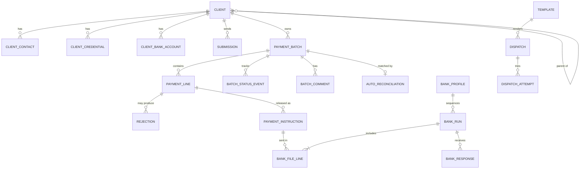

# PaymentGateway Database: Schema v1 (Draft, starting point)

**Status:** draft for approval. Full columns and constraints come in the WP3 migration scripts once the SQL Server version is known.

## Conventions
- One schema per future service: `ref`, `client`, `intake`, `payments`, `bank`, `notify`, `audit`, `sync`.
- `datetime2` in UTC; `decimal(18,2)` for money (not `money`).
- `rowversion` on edited tables (optimistic concurrency).
- `Legacy…Id` columns point back to the old `BulkPayments` rows during migration.
- No hard deletes: rows are cancelled or deactivated, never removed.
- PII (ID/passport numbers) encrypted; account numbers masked in UI and logs (POPIA).

## `ref`: lookups
| Table | Key columns |
|---|---|
| `ServiceType` | Id, Code (SDV/RTL/1DAY/2DAY/DW), Description, MinLeadDays, CutOffTime |
| `PublicHoliday` | Date, Name |
| `Setting` | Key, Value |
| `ReconStatus`, `PaymentStatus`, `LineStatus`, `BankRunStatus`, `AccountType` | Id, Code, Description |

## `client`: Client API
| Table | Key columns | Notes |
|---|---|---|
| `Client` | ClientId, ParentClientId → Client, ExternalClientId, Name, Status, AutoProcess, LogoRef | One table for primary and secondary clients; secondaries point to their primary |
| `ClientContact` | ClientId, Type (Upload/Rejection/Funding/Confirmation), Name, Email, Cell | Replaces the `NotificationXml` blob |
| `ClientCredential` | ClientId, KeyHash, KeyPrefix, CreatedAt, RevokedAt | Hashed access keys only |
| `ClientBankAccount` | ClientId, Purpose (Nominated/Charges/Rejection), AccountName, AccountNo, BranchCode, AccountType | |
| `BillingRate` | ClientId, ServiceTypeId, Rate, EffectiveFrom | |

## `intake`: Batch File API
| Table | Key columns | Notes |
|---|---|---|
| `Submission` | SubmissionId, BatchReference (GUID), ClientId, UniquePaymentReference, Channel (SOAP/REST), PayloadHash, PayloadRef, Status, ResponseJson, ReceivedAt | UNIQUE(ClientId, UniquePaymentReference) blocks duplicate uploads |
| `SubmissionError` | SubmissionId, LineNo, Field, Code, Message | Line-level validation errors |

## `payments`: Payments API
| Table | Key columns | Notes |
|---|---|---|
| `PaymentBatch` | BatchId, BatchReference, ClientId, ClientName, UniquePaymentReference, ServiceTypeId, PaymentDate, ControlRecordCount, ControlTotal, ReconStatus, ReconSource (Manual/Statement), PaymentStatus (Pending/Released/Submitted/Ack/Paid/PartiallyRejected/Cancelled), rejection account fields | SQL Server keeps its change history automatically (temporal table) |
| `PaymentLine` | LineId, BatchId, LineNo, EmployeeCode, Surname, FirstName, Initials, IdOrPassport (encrypted), Cell, Email, BranchCode, AccountNo, AccountType, Amount, BeneficiaryRef, LineStatus, RejectionReason, PaidAtUtc | Paid Away / History = `LineStatus = Success` by `PaidAtUtc` |
| `BatchContact` | BatchId, Type, Name, Email, Cell | Contacts sent with that particular upload |
| `BatchComment` | BatchId, Actor, Body, CreatedAt | |
| `BatchStatusEvent` | BatchId, From, To, Kind (Recon/Payment), Actor, Reason, OccurredAt | Append-only log of every status change |
| `Rejection` | RejectionId, LineId, BankRunRef, Reason, Status (PendingUnreconciled/Reconciled/Resubmitted/Paid), Amount | |
| `AutoReconciliation` | BatchId, StatementRef, AvailableBalance, Variance, MatchedAt | Fed by the Statements API |

## `bank`: Bank File API
| Table | Key columns | Notes |
|---|---|---|
| `BankProfile` | Bank, ClientIdentifier, RunningSequence, DailySequence, LastRunDate, WindowStart, WindowEnd, Halted | |
| `PaymentInstruction` | InstructionId, SourceType (Line/Rejection), SourceId, BatchReference, Account, BranchCode, Amount, ServiceType, ActionDate, Status | Frozen copy of what was released for payment |
| `BankRun` | BankRunId, ProfileId, FileName, FileSequenceNumber, Status (Created/Submitted/Ack/Nack/Duplicate), Trigger (Scheduled/Manual), RequestedBy, FileRef, totals | |
| `BankFileLine` | BankRunId, InstructionId, ItemNo, BankFileReference, Status, Reason | Many-to-many over time (resends) |
| `BankResponse` / `BankResponseLine` | Type (ACK/NACK/Unpaid), FileName, Hash, ReceivedAt, ProcessedAt / per-line results | |

## `notify`: Notifications API
| Table | Key columns | Notes |
|---|---|---|
| `Template` | TemplateId, ClientId (optional), Type, Channel (Email/SMS), Subject, Body, Version | |
| `Dispatch` | DispatchId, Type, ClientId, Channel, Recipients, Subject, Body, Attachments, Status (Queued/Sent/Failed), ReleaseAt | Replaces legacy `Dispatch` |
| `DispatchAttempt` | DispatchId, At, Provider, Result, Error | |

## `audit` and `sync`
- `audit.ActivityLog`: append-only copy of the legacy activity log.
- `sync.Checkpoint`, `sync.RunLog`, `sync.ErrorRow`: used by the legacy → new sync worker.

## Relationships

(In the database, cross-schema links are logical IDs, not foreign keys, so each service can later move to its own database.)

## Open items before the WP3 scripts
- SQL Server version and edition: decides temporal tables (2016+), ledger tables (2022+) and Always Encrypted.
