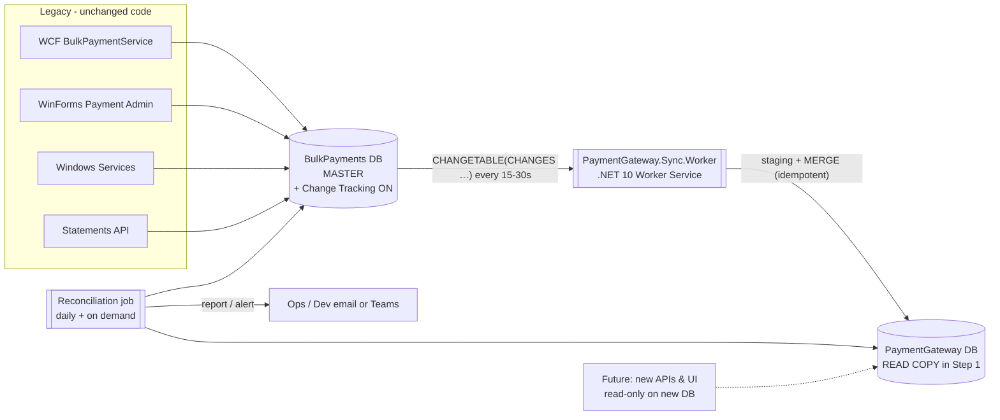

# Step 1 Plan: New PaymentGateway Database + Continuous Sync from the Legacy Database

**Status: DRAFT, for your review. Nothing will be implemented until you approve.**

---

## 1. Objective
Stand up the **new, modern `PaymentGateway` database** and keep it **continuously and verifiably in sync** with the legacy `BulkPayments` database, **with no code changes to any legacy application** (WCF service, WinForms Admin, Windows Services, Statements API).

When Step 1 is done:
- Every client, batch, payment line, comment, rejection, bank run, auto-reconciliation and notification in the old DB also exists in the new DB, in the new structure, within about a minute.
- A daily reconciliation proves both databases agree (counts and Rand totals).
- You can start building new APIs and screens on the new DB (read-only at first) without touching the old system.

## 2. Scope

| In scope | Out of scope for Step 1 (later steps) |
|---|---|
| New solution/repo skeleton (.NET 10) | Any new API endpoints or UI |
| New DB schema v1 + migration tooling | Writing payment state from the new side (reconcile, bank files) |
| Turning on SQL Server Change Tracking on the legacy DB (a DB setting; app code untouched) | CoreWCF service (Step 2, can run in parallel, see §12) |
| Sync worker (legacy → new), initial load + incremental | Reverse sync (new → legacy) |
| Reconciliation job + report + alerts | Migrating `_Rej`, `Wingate*`, `Header_Audit`, `ErrorLog`, `TableColumns`, `BillingMaintenance` (archive later) |
| Automated tests, local dev environment, CI | Production cut-over of anything client-facing |

## 3. Constraints and principles
1. **Legacy app code is not changed.** The only legacy-side changes are DB settings: Change Tracking, possibly snapshot isolation (§6.3), and possibly primary keys on 2 small tables (§6.4). Each needs DBA sign-off and has a rollback script.
2. **The old DB stays the master.** The new DB is a **read copy** in Step 1. Nothing in the new system writes payment state yet.
3. **The sync is idempotent and restartable.** It can be re-run, paused or rebuilt at any time without duplicating data.
4. **Every legacy row is traceable.** New tables carry `Legacy*Id` columns.
5. **Money reconciles.** Counts and totals per client, per payment date and per status are compared automatically every day.

## 4. Target picture after Step 1



---

## 5. Work packages

### WP1. Repository and solution skeleton
**Tasks**
- New Git repo `PaymentGateway`, separate from the legacy repo.
- .NET 10 solution with `Directory.Build.props` (nullable, warnings as errors, analyzers), `Directory.Packages.props` (central package versions), `.editorconfig`, `global.json`.
- Projects:
  ```
  src/
    PaymentGateway.Database/            DbUp migrations (plain .sql, DBA-reviewable) + console runner
    PaymentGateway.Sync.Worker/         Worker Service host (Windows Service or container)
    PaymentGateway.Sync.Core/           Change readers, mappers, upsert writers (no hosting code)
    PaymentGateway.Reconciliation/      Recon queries, report, alerts (job inside the worker + CLI)
    PaymentGateway.SharedKernel/        Status enums, ServiceType mapping, clock, hashing
  tests/
    PaymentGateway.Sync.UnitTests/      Mapper tests (pure)
    PaymentGateway.Sync.IntegrationTests/  Testcontainers SQL Server: legacy schema + new schema, end-to-end scenarios
  deploy/
    docker-compose.yml                  SQL Server 2022 (legacy + new DBs), seq/otel collector
    legacy-db/                          bulkpayments_script.sql baseline + synthetic seed data
  ```
- CI pipeline (GitHub Actions or Azure DevOps): build, unit tests, integration tests (Docker), migration dry-run.

**Done when:** a clean clone runs `docker compose up` + `dotnet test` and gets green, with both DBs created locally.

### WP2. Legacy DB baseline under source control
**Tasks**
- Put `bulkpayments_script.sql` into `deploy/legacy-db/` as the baseline.
- Build a **synthetic, anonymised seed data** generator: clients, batches across all recon statuses, bank runs, ACK/NACK, rejections, dispatches. No production PII in the repo.
- Optional: a script to restore a **masked copy of production** into a test environment for the 10-day parallel run (§10).

**Done when:** the legacy DB can be recreated locally and in CI with realistic data covering every status.

### WP3. New database schema v1 (`PaymentGateway`)
A separate database on the same SQL Server instance to start, with one schema per future service. v1 contains only what's needed to mirror legacy, plus the structural fixes we agreed:

| Schema | Tables (v1) |
|---|---|
| `ref` | `ServiceType`, `ReconStatus`, `PaymentStatus`, `LineStatus`, `BankRunStatus`, `AccountType`, `PublicHoliday`, `Setting` |
| `client` | `Client` (primary + secondary, self-referencing), `ClientContact`, `ClientCredential` (hashed key, see §6.6), `ClientBankAccount`, `BillingRate` |
| `payments` | `PaymentBatch` (temporal), `BatchContact` (per-batch notification contacts from `Header.NotificationXml`), `PaymentLine`, `BatchComment`, `BatchStatusEvent` (append-only), `Rejection`, `AutoReconciliation` |
| `bank` | `BankProfile`, `BankRun`, `BankFileLine` (links lines/rejections to bank runs: many-to-many over time) |
| `notify` | `Template`, `Dispatch` |
| `audit` | `ActivityLog` (append-only copy) |
| `sync` | `Checkpoint` (last Change Tracking version per table), `RunLog`, `ErrorRow` (dead-letter), `IdMap` where needed |

Conventions: `datetime2(3)` UTC, `decimal(18,2)`, `rowversion` on mutable tables, `Legacy*Id` unique columns, status lookup tables with foreign keys, encrypted `IdOrPassport` (app-level encryption in v1, Always Encrypted later if the edition allows), no hard deletes.

**Tasks**
- Write DbUp migration scripts `0001_ref.sql` … `0007_sync.sql` plus seed scripts for lookups.
- An ER diagram and data dictionary in `/docs`.
- Fix the issues found in `PaymentGateway Scripts.sql` (broken FKs, batch/bank-run conflation, NOT NULL bank-run FK on client batches).

**Done when:** migrations run cleanly on an empty server and re-run without changes; schema review signed off by you (and a DBA if you have one).

### WP4. Legacy → new mapping specification
A written, reviewed mapping that the mapper tests are built from.

| Legacy | New | Key rules |
|---|---|---|
| `PrimaryClient` | `client.Client` (ParentClientId NULL) | `UniqueClientId` → `ExternalClientId`; `LogoFilename` → `LogoRef` |
| `SecondaryClient` | `client.Client` (ParentClientId = mapped primary) | `NotificationXml` parsed → `client.ClientContact` (Upload / Rejection / Funding). `AccessKey` → **hash only** in `ClientCredential` |
| `Header` | `payments.PaymentBatch` | `BatchId` (GUID) → `BatchReference`; `ReconStatusId` 1/2/3 → Reconciled/Unreconciled/Discrepancy; `PaymentStatus` **derived** (no `BankRunId` → Pending; `BankRunId` + run status → Submitted/Ack/Nack; all lines success → Paid; some rejected → PartiallyRejected); `Records`/`TotalValue` → control count/total; `NotificationXml` → `payments.BatchContact` |
| `Header` **delete** (`sp_Header_Delete`) | `PaymentBatch.PaymentStatus = Cancelled` + `BatchStatusEvent` | The row is kept, never deleted |
| `Transactions` | `payments.PaymentLine` | Joined to batch via `BatchId` GUID; `LineNo` = order of `TransactionId` within the batch; `TransactionStatusId` mapped (1 Pending, 2 Transmitted, 3 **Success**, 4 Rejected, 5 PendingUnreconciled); `BankFileReference` + batch's `BankRunId` → `bank.BankFileLine`; `ModifiedDate` at the change to Success → `PaidAtUtc` |
| `HeaderComment` | `payments.BatchComment` | No PK today (see §6.4) |
| `Rejections` | `payments.Rejection` (+ `bank.BankFileLine` when resubmitted) | Linked to the line via `TransactionId` |
| `BankRun`, `BankClientProfile` | `bank.BankRun`, `bank.BankProfile` | Status mapping Sent/Ack/Nack/Duplicate |
| `ReconciledBatches` (Statements API) | `payments.AutoReconciliation` + `PaymentBatch.ReconSource = Statement` when `IsReconciled = 1` | Joined on `BatchId` |
| `Dispatch`, `NotificationTemplate` | `notify.Dispatch`, `notify.Template` | Template has no PK (see §6.4) |
| `ActivityLog` | `audit.ActivityLog` | Insert-only, synced by identity high-water mark (no PK needed) |
| `PublicHoliday`, `ServiceType`, `Settings`, `BillingRates` | `ref.*`, `client.BillingRate` | Small tables: full compare each cycle |

**Paid Away / History (confirmed):** both tabs show items whose `TransactionStatus` is **Success (3)**. Paid Away = paid today; History = paid within a chosen date range. In the new DB they become one query over `payments.PaymentLine` where `LineStatus = Success` (rolled up per batch), filtered by `PaidAtUtc`. A batch is `Paid` when all its lines are Success, and `PartiallyRejected` when some are Success and some Rejected.

**Done when:** you have reviewed and approved the mapping, especially the derived `PaymentStatus` rules.

### WP5. Enable Change Tracking on the legacy DB (DBA change, no app change)
```sql
ALTER DATABASE BulkPayments SET CHANGE_TRACKING = ON (CHANGE_RETENTION = 7 DAYS, AUTO_CLEANUP = ON);
ALTER TABLE dbo.Header          ENABLE CHANGE_TRACKING;
ALTER TABLE dbo.Transactions    ENABLE CHANGE_TRACKING;
ALTER TABLE dbo.Rejections      ENABLE CHANGE_TRACKING;
ALTER TABLE dbo.BankRun         ENABLE CHANGE_TRACKING;
ALTER TABLE dbo.BankClientProfile ENABLE CHANGE_TRACKING;
ALTER TABLE dbo.PrimaryClient   ENABLE CHANGE_TRACKING;
ALTER TABLE dbo.SecondaryClient ENABLE CHANGE_TRACKING;
ALTER TABLE dbo.ReconciledBatches ENABLE CHANGE_TRACKING;
ALTER TABLE dbo.Dispatch        ENABLE CHANGE_TRACKING;
-- + HeaderComment / NotificationTemplate once they have a PK (§6.4)
```
- A dedicated SQL login for the sync, with `SELECT` + `VIEW CHANGE TRACKING` on those tables only.
- A rollback script (`DISABLE CHANGE_TRACKING`).
- Measure the overhead on a test copy under month-end-like load before production.

**Done when:** the script is approved by the DBA and applied to the test environment; overhead is measured and accepted.

### WP6. Sync worker
**Flow per cycle (every 15–30 s, configurable):**
1. Read `CHANGE_TRACKING_CURRENT_VERSION()` inside a **snapshot isolation** transaction, so all tables are read at one consistent point.
2. For each table, **in dependency order** (ref → clients → bank profile/runs → headers → transactions → comments/rejections → auto-recon → dispatch → activity log):
   - If `CHANGE_TRACKING_MIN_VALID_VERSION(table)` > the saved checkpoint (the worker was down longer than the retention period), **re-snapshot that table automatically**.
   - Read changed keys via `CHANGETABLE(CHANGES dbo.X, @lastVersion)` joined to the current rows (including deletes).
   - Map rows to new rows (pure, unit-tested mappers).
   - `SqlBulkCopy` into a staging table, then a set-based `MERGE`/upsert keyed on `Legacy*Id` (idempotent).
3. Save the new checkpoints **in the same transaction** as the writes into the new DB, so a crash never skips or double-applies changes.

**Initial load:** chunked snapshot by identity ranges (e.g. 50k rows per chunk) for large tables (`Transactions`, `ActivityLog`). It is resumable, and Change Tracking captures changes made during the load.

**Error handling:** a row that fails mapping goes to `sync.ErrorRow` with the reason and payload, and the cycle continues. Orphans (e.g. a line whose batch isn't synced yet) are retried on the next cycle. Repeated failures raise an alert.

**Operations:** health endpoint, structured logs (Serilog), metrics: sync lag (seconds), rows per table per cycle, errors, re-snapshots. Runs as a Windows Service (`UseWindowsService`) on an existing server or as a container.

**Done when:** the end-to-end integration scenarios in §8 pass, and a kill-restart test mid-cycle loses or duplicates nothing.

### WP7. Reconciliation job
Daily (configurable) and on demand via CLI. It compares old vs new:
- Clients: count per primary; active secondaries.
- Batches: count and `SUM(TotalValue)` **per client × payment date × recon status**.
- Lines: count and `SUM(Amount)` per batch and per line status.
- Rejections: count and sum per status.
- Bank runs: count per status per day; lines per run.
- Dispatch: count per status per day.
- Spot check: 100 random batches compared field by field.

Output: an HTML/CSV report, a status row in `sync.RunLog`, and an email/Teams alert on any difference or on lag above the threshold.

**Done when:** the report runs in CI against seeded data showing zero differences, and a deliberately introduced difference is detected.

### WP8. Tests
- **Unit:** every mapper rule in WP4, including derived payment status, NotificationXml parsing (malformed XML goes to the error table), and ServiceType aliases.
- **Integration (Testcontainers SQL Server 2022):** the legacy schema is created from the baseline script and the new schema from migrations. Legacy stored procs (`sp_Header_Insert`, `sp_Header_BulkUpdate`, `sp_Header_Delete`, `sp_BankRuns_Insert`, `sp_Transactions_BulkUpdateIncoming`, `sp_Rejections_Insert`, …) are called to simulate real app behaviour, and the new DB is asserted after the sync.
- **Scenarios:** upload → unreconciled → reconciled → bank run → ACK → paid; NACK → resend; unpaid → rejection → resubmission; header deleted → cancelled; payment date/service type change; Statements auto-recon; worker down past retention → re-snapshot.

### WP9. Test-environment parallel run
- Restore a **masked copy of production** into a test environment, apply WP5, deploy the worker, and replay activity (or point it at a production read replica if you have one).
- Run for **10 business days, including a month-end**, with zero reconciliation differences and p95 lag under 60 s.
- Go/no-go for running the sync against production.

---

## 6. Design decisions: **APPROVED as recommended (2026-11-01)**

| # | Decision | Recommendation | Alternatives |
|---|---|---|---|
| 6.1 | Where the new DB lives | Separate DB `PaymentGateway` on the **same SQL Server instance** to start | Separate server now (more isolation, more infrastructure) |
| 6.2 | Change capture | **Change Tracking** (all editions, lightweight; we re-read current rows) | CDC (full change history; needs SQL Agent; heavier) |
| 6.3 | Read consistency | Enable `ALLOW_SNAPSHOT_ISOLATION ON` on legacy (Microsoft's recommended pattern for Change Tracking). It adds tempdb version-store load, so the DBA must agree. | Read without snapshot isolation and rely on the next cycle to correct things (simpler, small risk of transient inconsistency) |
| 6.4 | Tables without a primary key (`HeaderComment`, `NotificationTemplate`, `BillingRates`, `PrimaryClientBankAccountType`) | `HeaderComment` and `NotificationTemplate` have identity columns, so add a PK on them. That is a **metadata-only change, no app impact**; check for duplicates first. The other two are tiny, so do a full compare each cycle. | Full compare for all four (no legacy schema change at all) |
| 6.5 | Migration tool | **DbUp** with plain SQL scripts (reviewable by DBAs and auditors) | EF Core migrations |
| 6.6 | Access keys in the new DB | Store only `HMAC-SHA256(pepper, key)`; the pepper lives in a secret store, never in the repo | Don't copy credentials until Step 2 |
| 6.7 | Data access in the worker | Dapper + `SqlBulkCopy` + set-based `MERGE` (fast, explicit) | EF Core (slower for bulk upserts) |
| 6.8 | Worker hosting | Windows Service on an existing app server (no new infrastructure) | Container (Docker/AKS) |

---

## 7. Timeline (rough, one developer, with me doing most of the build)

| Week | Work |
|---|---|
| 1 | WP1, WP2, WP3 draft → **your schema review** |
| 2 | WP4 mapping sign-off, WP5 on the test environment, WP6 for clients + batches + lines |
| 3 | WP6 for remaining tables, re-snapshot, error handling; WP7; WP8 scenarios |
| 4–5 | WP9: 10-business-day parallel run including month-end; fixes |

## 8. Acceptance criteria for Step 1
- [ ] No legacy application binaries or code changed.
- [ ] The new DB holds all in-scope legacy data in the new structure, with traceable `Legacy*Id`s.
- [ ] Sync lag p95 < 60 s; automatic recovery from restart and from exceeding retention.
- [ ] Daily reconciliation shows **zero differences for 10 consecutive business days, including a month-end**.
- [ ] Change Tracking overhead on the legacy DB measured and accepted.
- [ ] CI green: unit, integration and migration tests.
- [ ] Runbook: start/stop, re-snapshot a table, read the recon report, roll back Change Tracking.

## 9. Risks

| Risk | Mitigation |
|---|---|
| Change Tracking or snapshot isolation adds load on the production DB | Measure on the test copy first; tune polling interval and retention; DBA approval |
| Hidden business meaning in statuses | Mapping sign-off (WP4); field-by-field spot checks |
| Malformed `NotificationXml` in old rows | Parse defensively; dead-letter with reason; report counts |
| Legacy hard deletes | Change Tracking reports deletes; mapped to Cancelled, never removed |
| PII leaking into dev/test | Synthetic seed data in the repo; masked production copy only in a controlled test environment |

## 10. What I need from you before starting
1. **Approval of this plan**, or changes to it.
2. **New repo:** on GitHub, connected to Devin. Repo name still to come.
3. **SQL Server version and edition**, and whether the new DB can go on the same instance (6.1).
4. **DBA contact/approval** for Change Tracking, snapshot isolation and the two primary keys (6.3, 6.4).
5. ~~Decisions 6.1–6.8~~: approved as recommended. You act as DBA; I advise and you approve final decisions.
6. ~~Paid Away / History meaning~~: confirmed. Both are based on `TransactionStatus = Success` (see WP4).

## 11. First implementation slice (once you approve)
1. WP1 repo skeleton + CI.
2. WP2 legacy DB in Docker with synthetic data.
3. WP3 schema v1 migrations, sent to you for review **before** writing any sync code.

## 12. Optional parallel track (no dependency on Step 1)
R0 safety net for the client service: capture the production WSDL/XSD baseline, set up SOAP traffic recording, and write golden tests for upload validation quirks. This prepares Step 2 (CoreWCF) and can start whenever you're ready.
